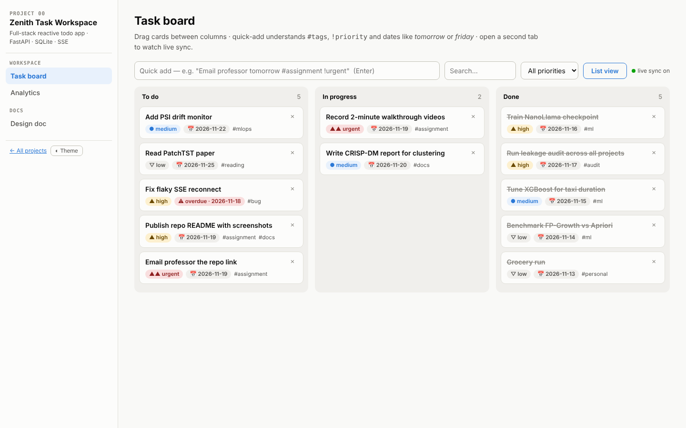
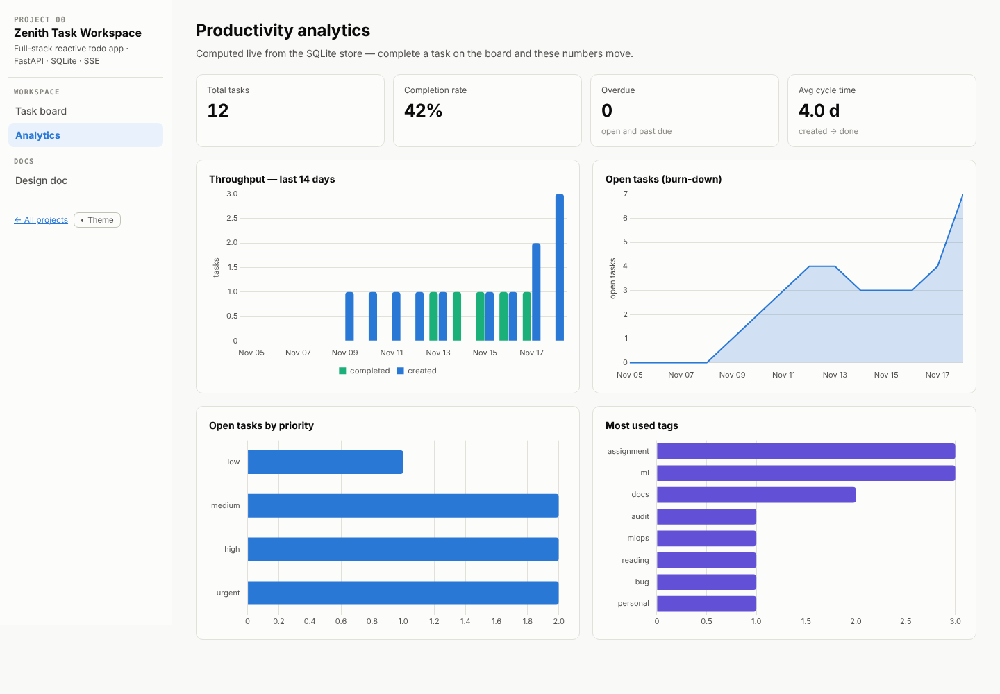
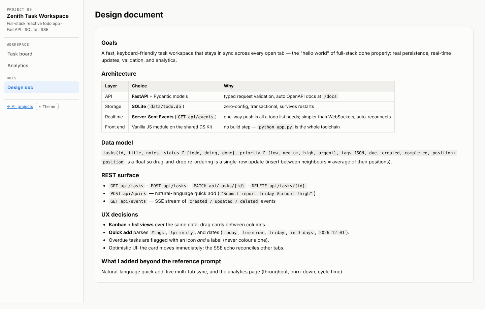

# Project 00 — Zenith Task Workspace

> Full-stack reactive todo app · FastAPI · SQLite · SSE

**Walkthrough video (2 min):** _add link in `videos.json`_

## What it is
A real-time task workspace: FastAPI REST API with Pydantic validation, SQLite persistence, Server-Sent Events for live multi-tab sync, and a kanban/list SPA.

## Run it
```bash
# from the repository root
python run.py 00          # → http://127.0.0.1:8000
python run.py             # or the hub with all 16 projects → http://127.0.0.1:8000
```

## Results
- 12 seeded demo tasks; full CRUD + quick-add + SSE verified by API tests and a browser test of every page.
- Invalid input returns HTTP 422 (empty title, unknown status/priority); unknown ids return 404.

## What I added beyond the reference prompt
- Natural-language quick add — `Email professor tomorrow #assignment !urgent` is parsed into title, due date, tag and priority (`parse_quick` in `app.py`).
- Live sync across tabs over SSE (`GET api/events`) with optimistic UI updates.
- Analytics page computed from the database: throughput, burn-down, cycle time, tags.
- A design document page explaining every architectural choice.

## Pages
- **Task board** (Workspace)
- **Analytics** (Workspace)
- **Design doc** (Docs)

## Code map
- `app.py` — API, SQLite storage, SSE hub, quick-add parser, analytics
- `web/custom.js` — kanban board, drag & drop, filters, EventSource client
- `../common/` — shared app factory, UI kit (`kit/kit.js`), AutoResearch hill-climber, static auditor

## Prompt this project replicates
```text
in a directory fullstack-test - build a modern end2end dynamic todo list application industry best experience of ux and nice features - make reasonable assumptions.
```

## Screenshot tour
### Board


### Analytics


### Design


