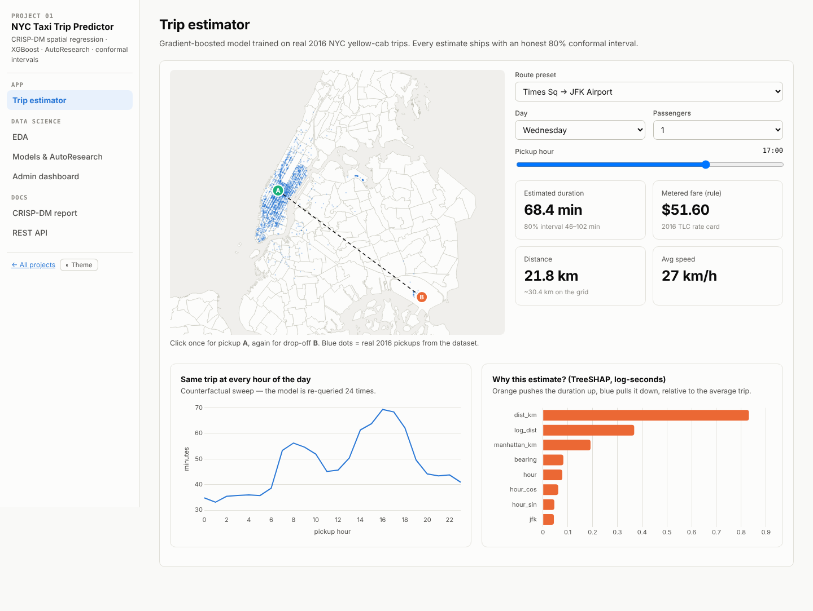
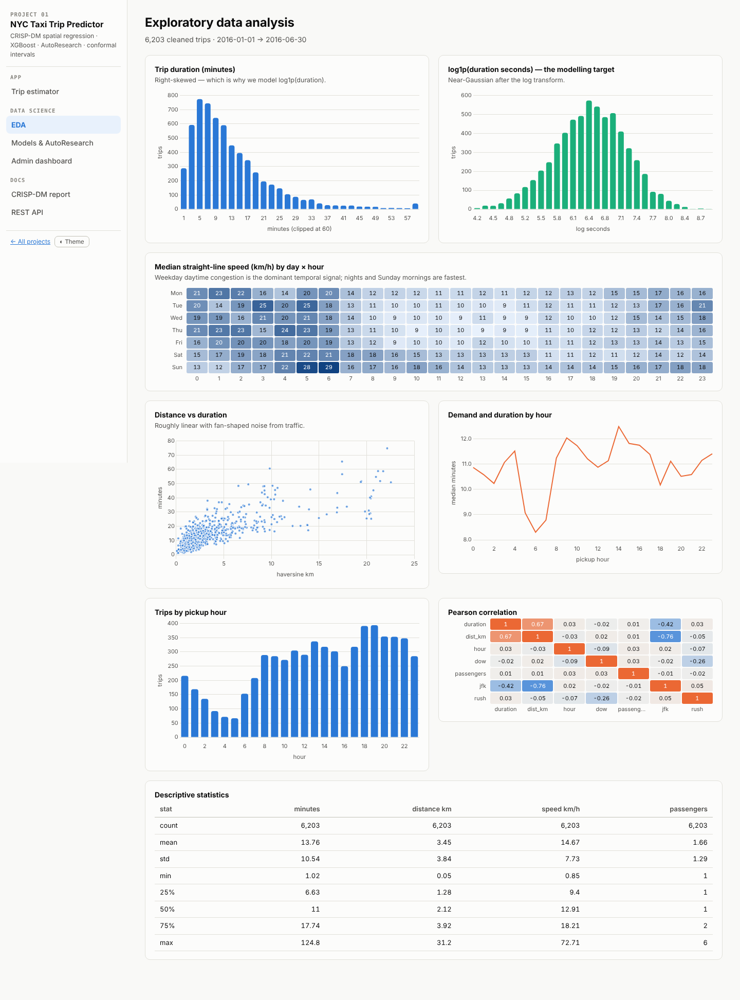
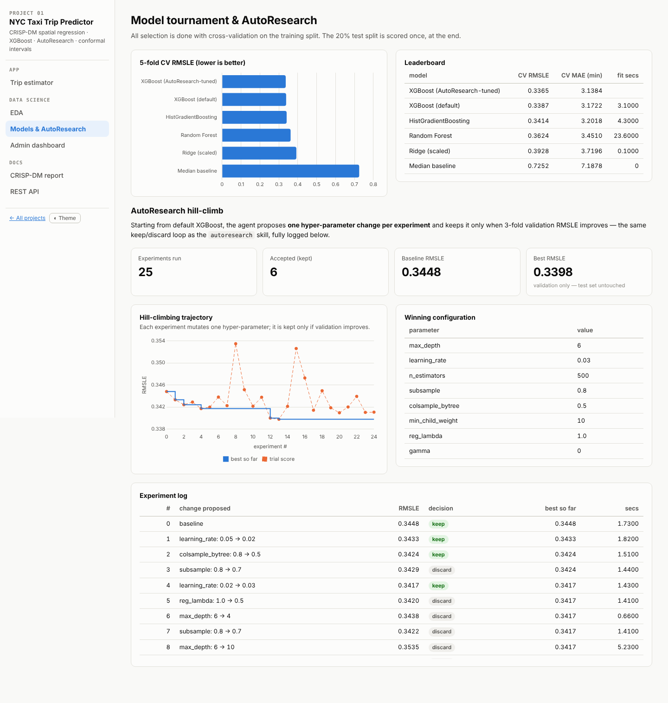
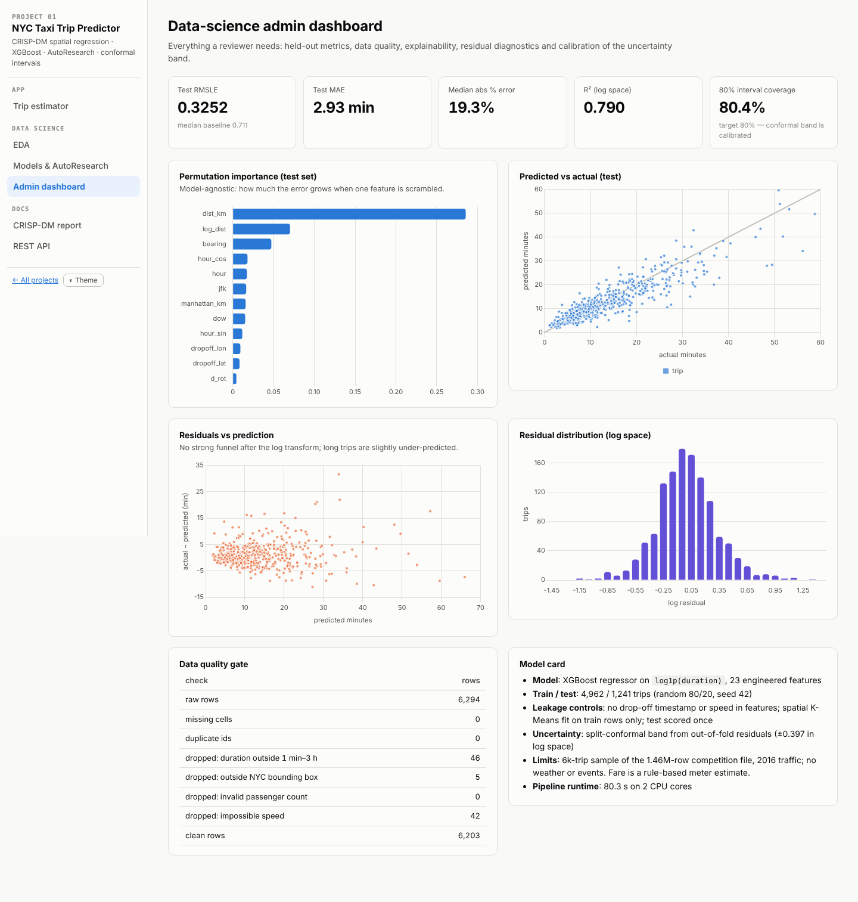
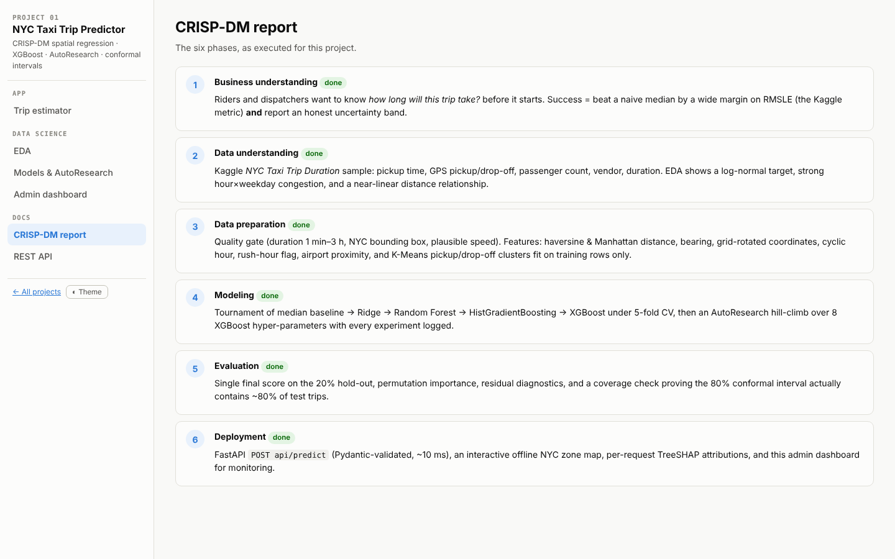
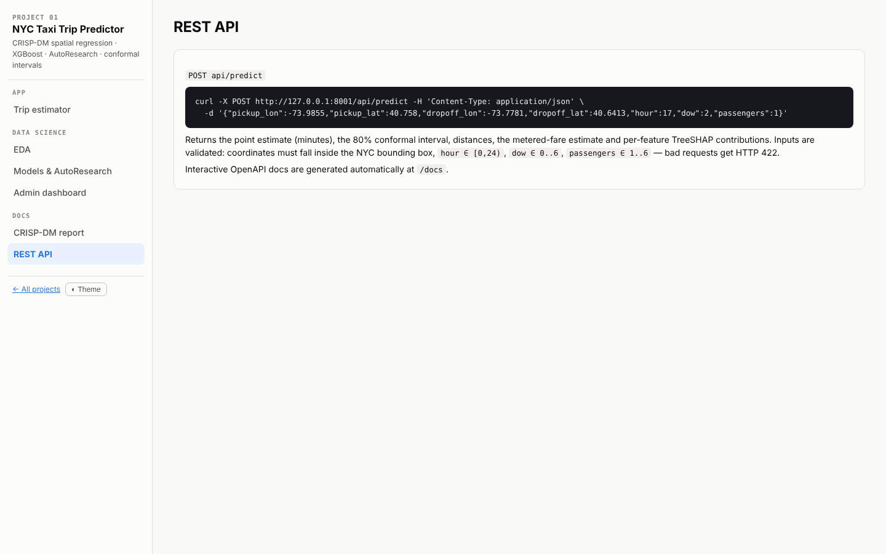

# Project 01 — NYC Taxi Trip Predictor

> CRISP-DM spatial regression · XGBoost · AutoResearch · conformal intervals

**Walkthrough video (2 min):** _add link in `videos.json`_

## What it is
Trip-duration prediction on a sample of the Kaggle NYC Taxi Trip Duration data, with an interactive offline map of the 263 TLC taxi zones, a model tournament, AutoResearch hill-climbing and a data-science admin dashboard.

## Run it
```bash
# from the repository root
python run.py 01          # → http://127.0.0.1:8001
python run.py             # or the hub with all 16 projects → http://127.0.0.1:8000
python run.py train 01    # re-run the training pipeline and rebuild artifacts/
```

## Results (read from `artifacts/metrics.json` by `scripts/build_docs.py`)
- Data: 6,294 real trips → 6,203 after the quality gate.
- Test RMSLE **0.3252** vs 0.711 for the median baseline; MAE 2.93 min; R² (log) 0.790.
- 80% conformal interval covers **80.4%** of test trips.
- AutoResearch: 25 experiments, 6 kept.
- Limit: a ~6k-trip sample of the 1.46M-row competition file; the fare is a rule-based 2016 meter estimate, not learned.

## What I added beyond the reference prompt
- Split-conformal 80% prediction interval on every estimate, with its coverage verified on the test set.
- Per-request TreeSHAP explanation and a 24-hour counterfactual sweep for the same route.
- Offline vector map drawn from the TLC zone polygons — no tile server or API key.
- Spatial K-Means features fitted on training rows only; test set scored once.

## Pages
- **Trip estimator** (App)
- **EDA** (Data science)
- **Models & AutoResearch** (Data science)
- **Admin dashboard** (Data science)
- **CRISP-DM report** (Docs)
- **REST API** (Docs)

## Code map
- `pipeline.py` — quality gate, features, tournament, AutoResearch, conformal interval
- `app.py` — `POST api/predict`, dashboards
- `web/custom.js + common/kit/nycmap.js` — map estimator
- `../common/` — shared app factory, UI kit (`kit/kit.js`), AutoResearch hill-climber, static auditor

## Prompt this project replicates
```text
Now on to another project - You will do end2end a data science project of including data, training, deployment, crisp-dm framework, and an awesome front end. you can use Kaggle NYC taxi challenge. make sure that frontend includes interactive map and trip estimation.
```

## Screenshot tour
### Estimator


### Eda


### Models


### Admin


### Crispdm


### Api


