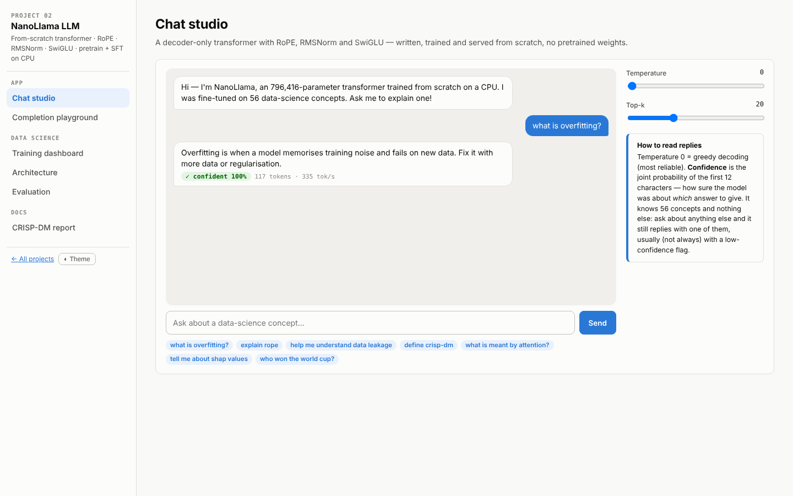
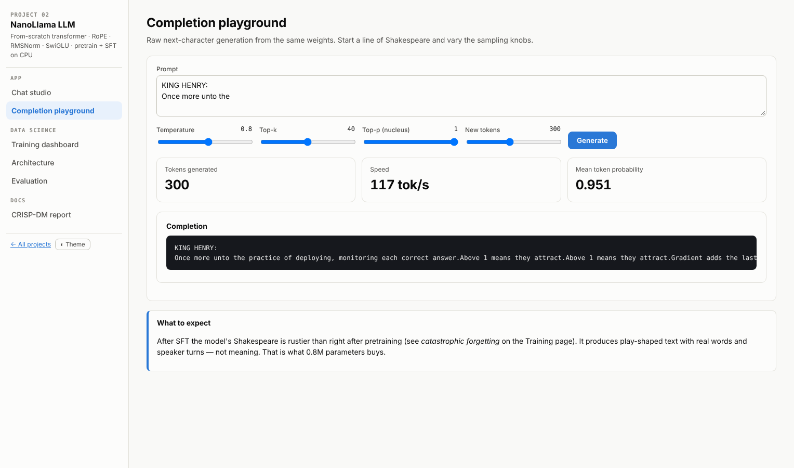
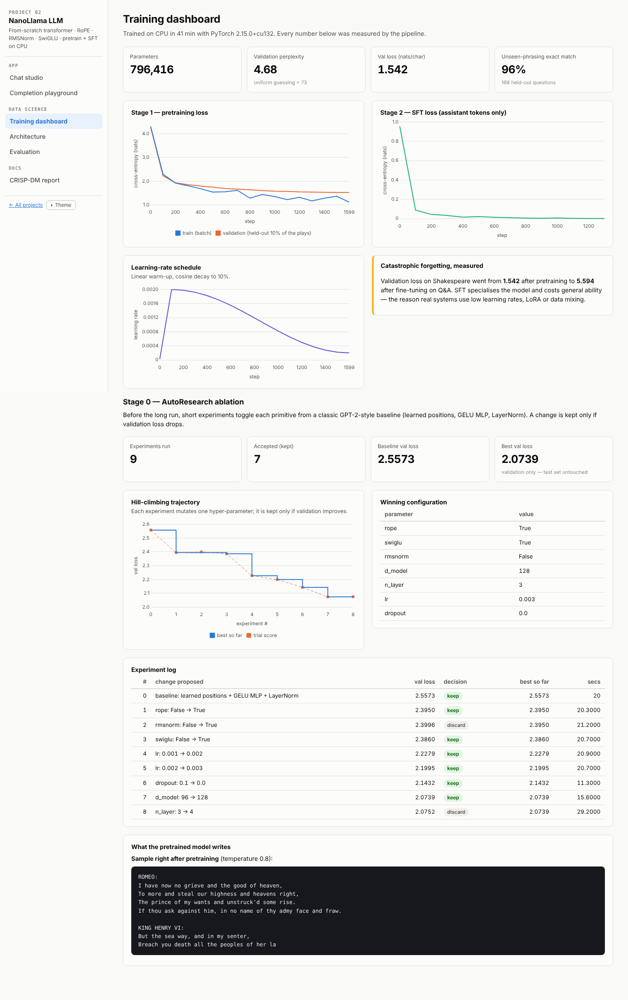
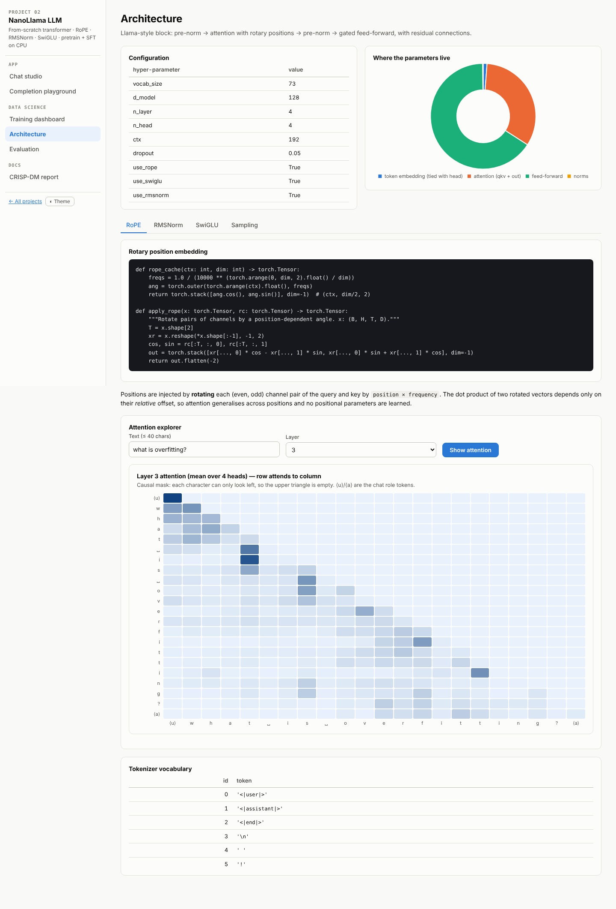
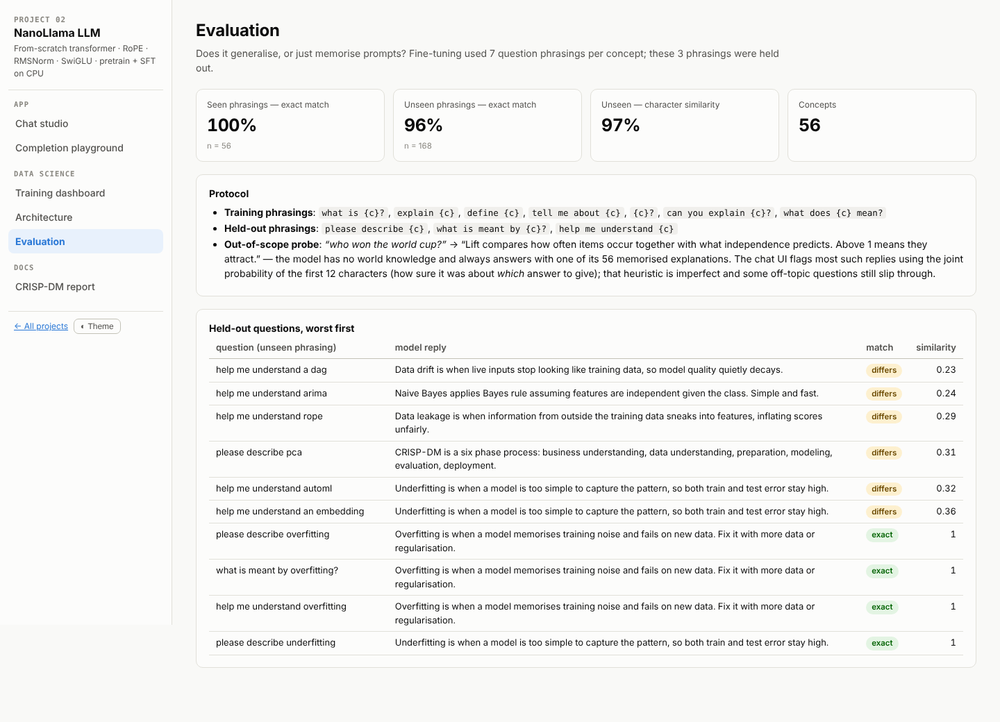
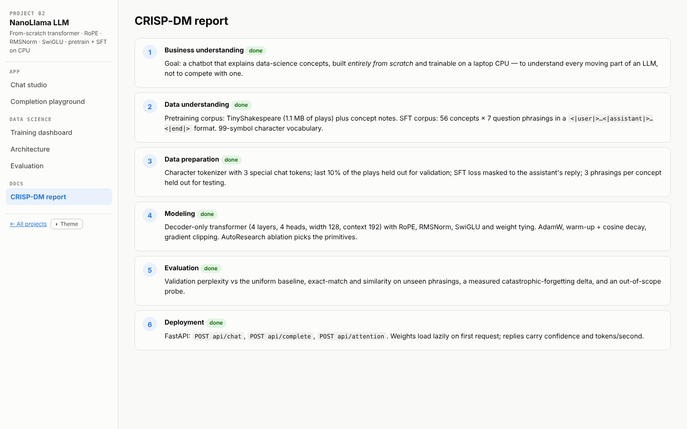

# Project 02 — NanoLlama LLM

> From-scratch transformer · RoPE · RMSNorm · SwiGLU · pretrain + SFT on CPU

**Walkthrough video (2 min):** _add link in `videos.json`_

## What it is
NanoLlama: a decoder-only transformer written from scratch in PyTorch with RoPE, RMSNorm, SwiGLU and weight tying; pretrained on TinyShakespeare and fine-tuned (SFT) into a data-science Q&A chatbot — all on CPU.

## Run it
```bash
# from the repository root
python run.py 02          # → http://127.0.0.1:8002
python run.py             # or the hub with all 16 projects → http://127.0.0.1:8000
python run.py train 02    # re-run the training pipeline and rebuild artifacts/
```

## Results (read from `artifacts/metrics.json` by `scripts/build_docs.py`)
- 796,416 parameters, 4 layers × 4 heads, width 128, context 192, 73-symbol character vocabulary.
- Validation perplexity **4.68** per character (uniform guessing = 73).
- SFT exact match: 100% on seen phrasings, **96.4%** on 168 unseen phrasings.
- Catastrophic forgetting: Shakespeare validation loss 1.542 → 5.594 after SFT.
- Trained in 41 min on 2 CPU cores. Limit: it knows 56 concepts and nothing else — off-topic questions get an unrelated memorised answer.

## What I added beyond the reference prompt
- Evaluation on question *phrasings never seen in fine-tuning*, so the score measures generalisation rather than prompt memorisation.
- Catastrophic forgetting is measured (validation loss before vs after SFT) and reported.
- Ablation agenda that toggles each primitive from a GPT-2-style baseline.
- Attention heat-map explorer and source-code tabs for every primitive.
- An honest out-of-scope signal: confidence is the joint probability of the first 12 characters (mean token probability turned out to be useless — it is ~0.99 even for wrong answers).

## Pages
- **Chat studio** (App)
- **Completion playground** (App)
- **Training dashboard** (Data science)
- **Architecture** (Data science)
- **Evaluation** (Data science)
- **CRISP-DM report** (Docs)

## Code map
- `model.py` — RoPE, RMSNorm, SwiGLU, attention, sampling
- `pipeline.py` — ablation, pretraining, SFT, evaluation
- `sft_data.py` — concepts and train / held-out phrasings
- `app.py + web/custom.js` — chat, playground, dashboards
- `../common/` — shared app factory, UI kit (`kit/kit.js`), AutoResearch hill-climber, static auditor

## Prompt this project replicates
```text
/teamwork-preview build a simple llm and chatbot (with state of art primitives but fit in my laptop gpu) - make sure you follow crisp-dm framework and also include nice data science admin dashboard. you can research the papers and implement autoresearch to do hill climbing and match the dashboard details with research paper. include all details a data scientist and ai engineer will care.
```

## Screenshot tour
### Chat


### Playground


### Training


### Architecture


### Evaluation


### Crispdm


