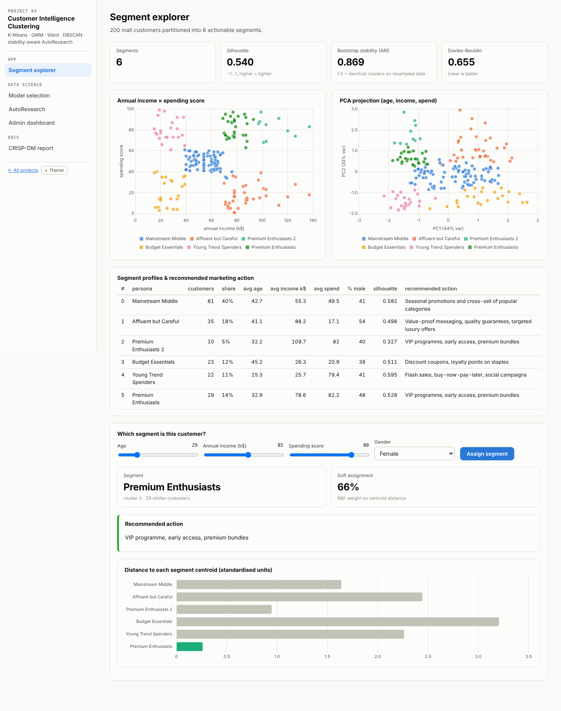
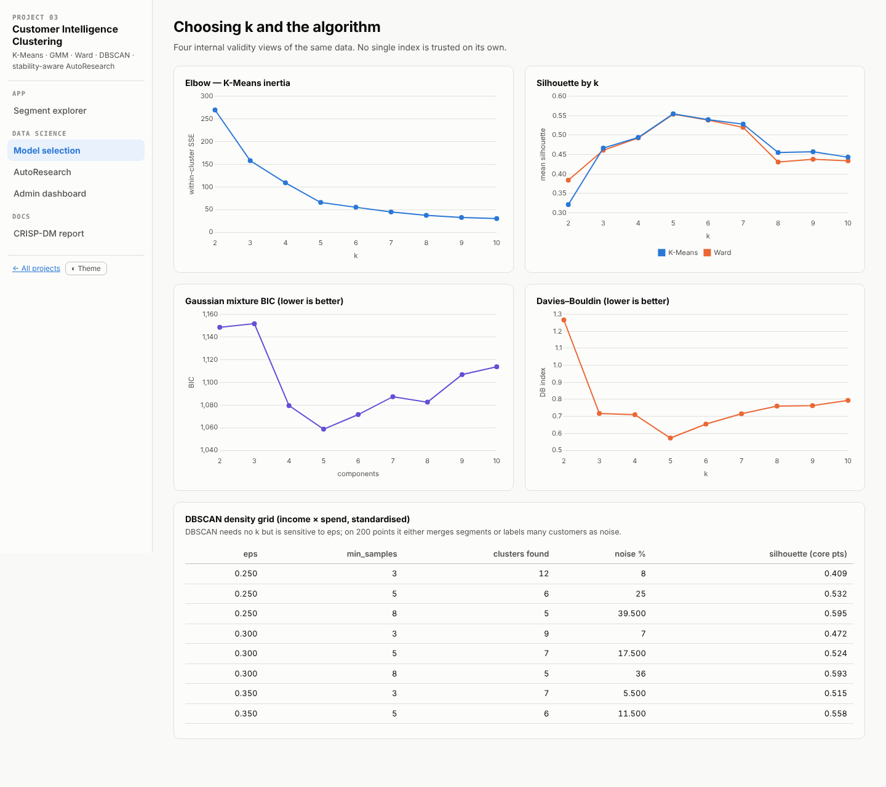
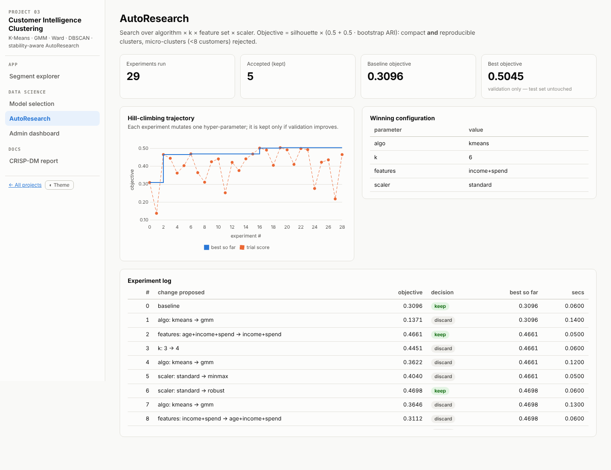
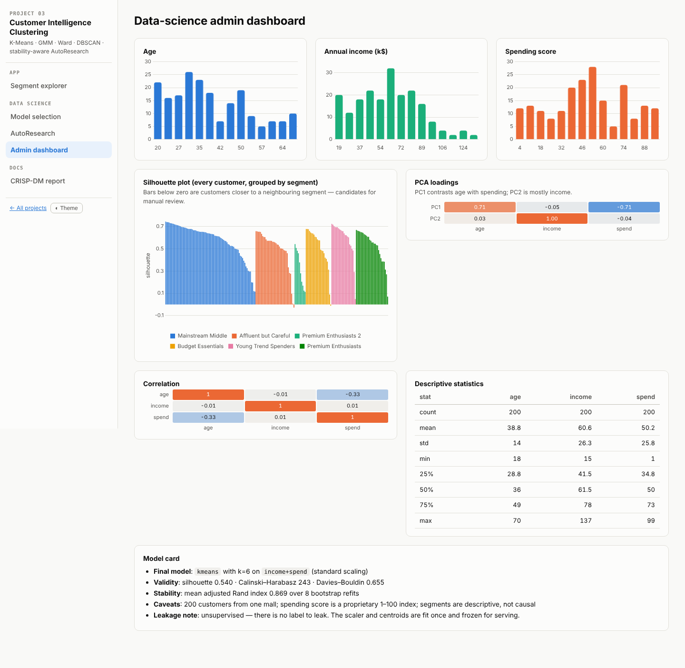
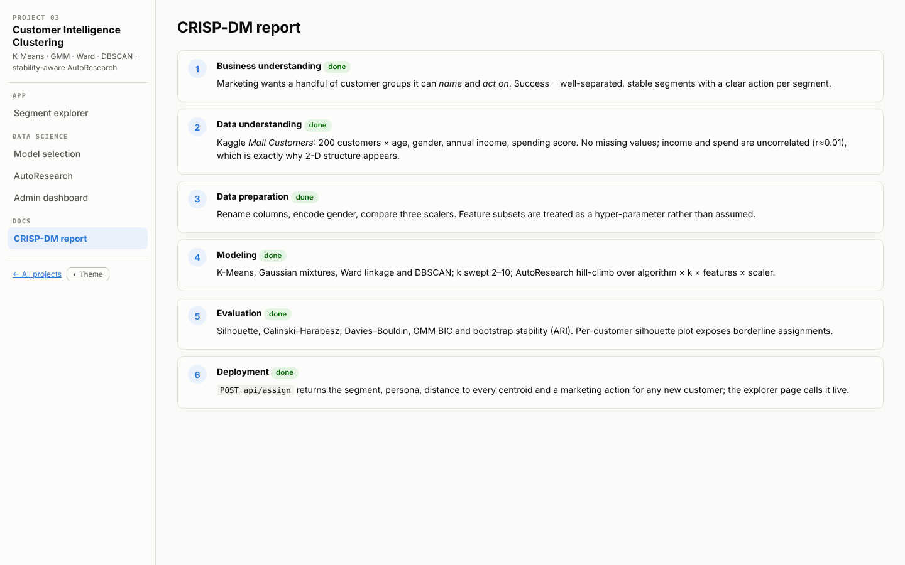

# Project 03 — Customer Intelligence Clustering

> K-Means · GMM · Ward · DBSCAN · stability-aware AutoResearch

**Walkthrough video (2 min):** _add link in `videos.json`_

## What it is
Customer segmentation on the Kaggle Mall Customers dataset: K-Means, Gaussian mixtures, Ward linkage and DBSCAN compared with four validity indices, a stability-aware AutoResearch search, named personas and a live assignment API.

## Run it
```bash
# from the repository root
python run.py 03          # → http://127.0.0.1:8003
python run.py             # or the hub with all 16 projects → http://127.0.0.1:8000
python run.py train 03    # re-run the training pipeline and rebuild artifacts/
```

## Results (read from `artifacts/metrics.json` by `scripts/build_docs.py`)
- Winner: `kmeans` with k = 6 on `income+spend`.
- Silhouette **0.540**, Davies–Bouldin 0.655, bootstrap stability (ARI) **0.869**.
- Segments: Mainstream Middle (81), Affluent but Careful (35), Premium Enthusiasts 2 (10), Budget Essentials (23), Young Trend Spenders (22), Premium Enthusiasts (29).
- Limit: 200 customers from one mall; segments are descriptive.

## What I added beyond the reference prompt
- The AutoResearch objective multiplies silhouette by bootstrap stability (adjusted Rand index), so it prefers clusters that reappear on resampled data.
- Rule-based persona names and a marketing action per segment.
- Per-customer silhouette plot to expose borderline assignments.

## Pages
- **Segment explorer** (App)
- **Model selection** (Data science)
- **AutoResearch** (Data science)
- **Admin dashboard** (Data science)
- **CRISP-DM report** (Docs)

## Code map
- `pipeline.py` — sweeps, DBSCAN grid, stability-aware AutoResearch, personas
- `app.py` — explorer, `POST api/assign`, dashboards
- `../common/` — shared app factory, UI kit (`kit/kit.js`), AutoResearch hill-climber, static auditor

## Prompt this project replicates
```text
/teamwork-preview Now lets do another project - clustering using popular kaggle data set - make sure you follow crisp-dm framework and also include nice data science admin dashboard. you can research the papers and implement autoresearch to do hill climbing and match the dashboard details with research paper. include all details a data scientist and ai engineer will care.
```

## Screenshot tour
### Explorer


### Selection


### Autoresearch


### Admin


### Crispdm


