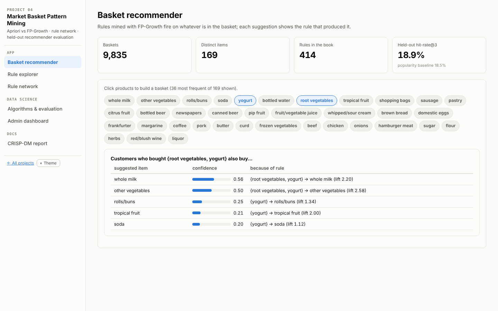
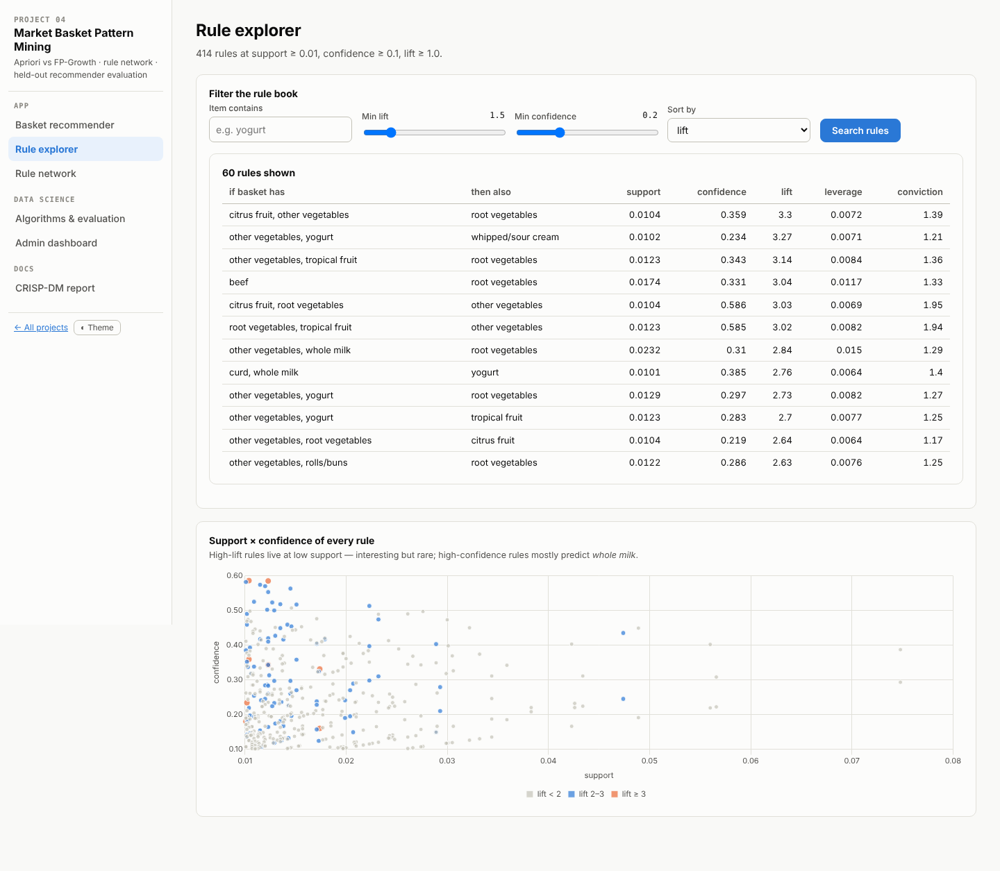
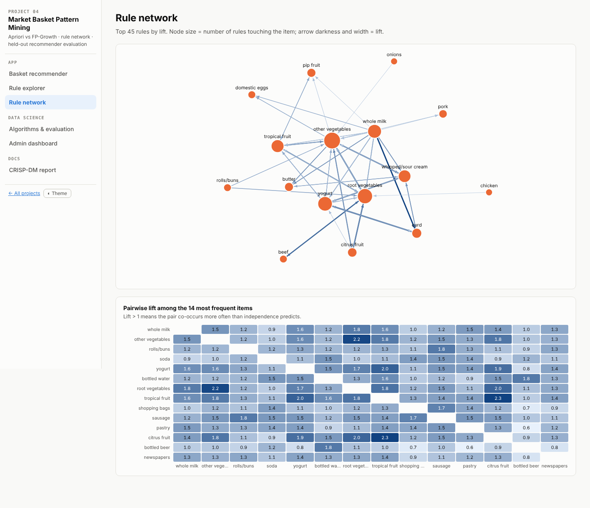
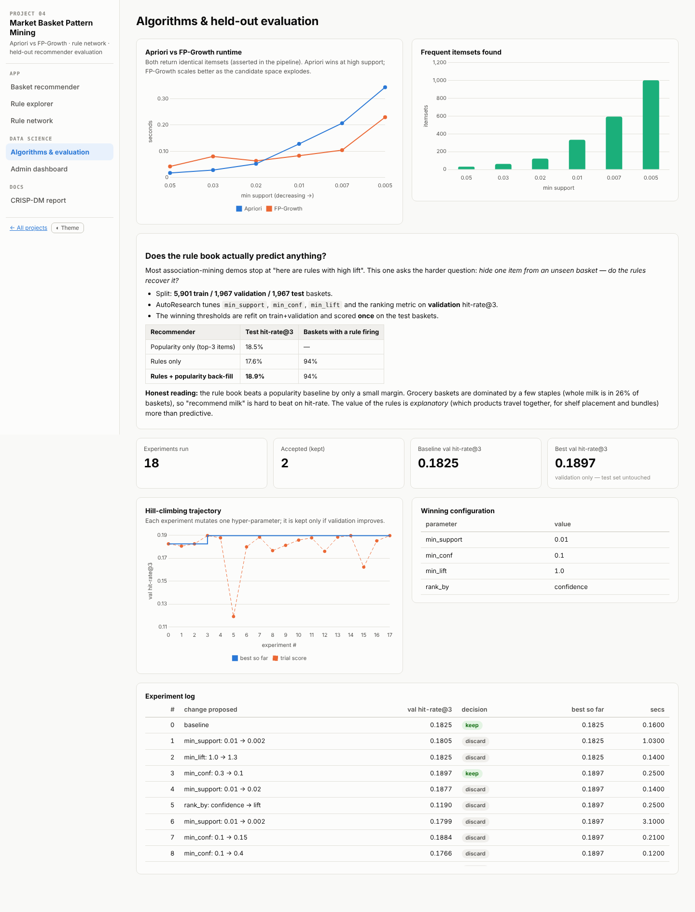
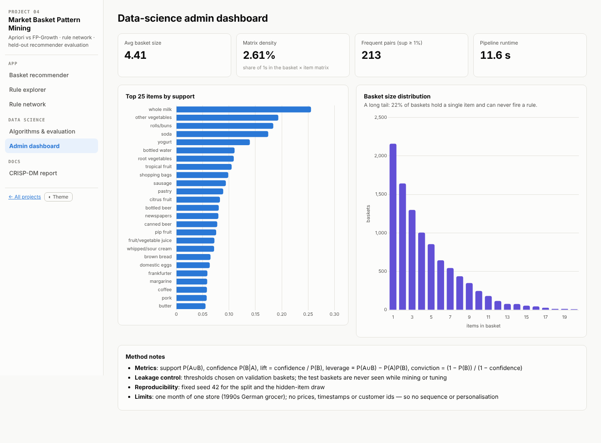
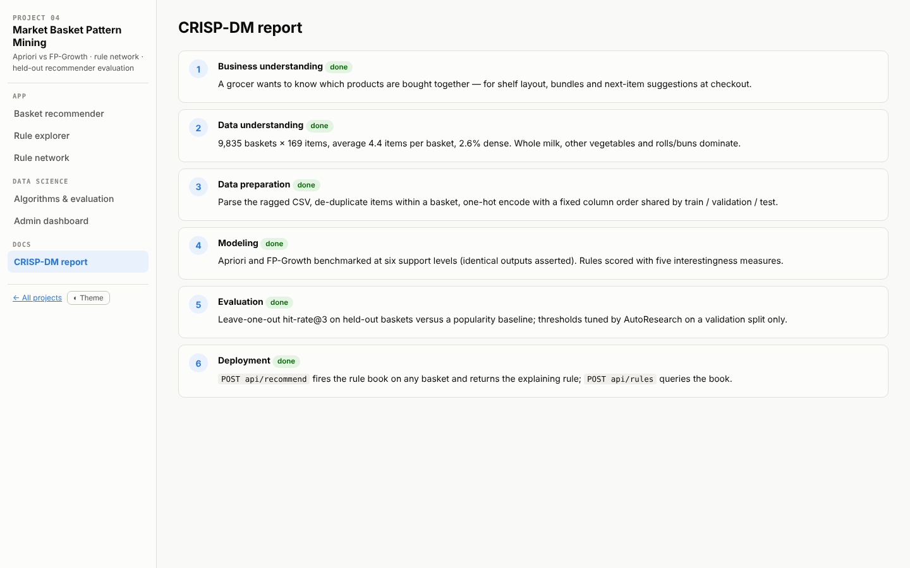

# Project 04 — Market Basket Pattern Mining

> Apriori vs FP-Growth · rule network · held-out recommender evaluation

**Walkthrough video (2 min):** _add link in `videos.json`_

## What it is
Market-basket mining on the Groceries dataset (9,835 baskets): Apriori vs FP-Growth benchmark, five interestingness measures, a rule network graph and a live rule-based recommender.

## Run it
```bash
# from the repository root
python run.py 04          # → http://127.0.0.1:8004
python run.py             # or the hub with all 16 projects → http://127.0.0.1:8000
python run.py train 04    # re-run the training pipeline and rebuild artifacts/
```

## Results (read from `artifacts/metrics.json` by `scripts/build_docs.py`)
- 9,835 baskets, 169 items, 414 rules at the tuned thresholds.
- Apriori and FP-Growth return identical itemsets (asserted); runtimes compared at six support levels.
- Held-out hit-rate@3: rules + popularity **18.9%** vs popularity alone 18.5%.
- Honest finding: the rule book only narrowly beats 'recommend the most popular items' — its value is explanatory (what is bought together), not predictive.

## What I added beyond the reference prompt
- A held-out evaluation, which association-mining demos usually skip: rules mined on training baskets are scored as a next-item recommender on unseen baskets (leave-one-out hit-rate@3) against a popularity baseline.
- AutoResearch tunes support / confidence / lift thresholds on a validation split only.
- Force-directed rule network and a pairwise-lift heat-map.
- Every recommendation shows the rule that produced it.

## Pages
- **Basket recommender** (App)
- **Rule explorer** (App)
- **Rule network** (App)
- **Algorithms & evaluation** (Data science)
- **Admin dashboard** (Data science)
- **CRISP-DM report** (Docs)

## Code map
- `pipeline.py` — mining, recommender, leave-one-out evaluation, AutoResearch
- `app.py` — `POST api/recommend`, `POST api/rules`
- `web/custom.js` — basket builder, rule network
- `../common/` — shared app factory, UI kit (`kit/kit.js`), AutoResearch hill-climber, static auditor

## Prompt this project replicates
```text
/teamwork-preview Now lets do another project - associative pattern mining using popular kaggle data set - make sure you follow crisp-dm framework and also include nice data science admin dashboard. you can research the papers and implement autoresearch to do hill climbing and match the dashboard details with research paper. include all details a data scientist and ai engineer will care.
```

## Screenshot tour
### Recommender


### Rules


### Graph


### Bench


### Admin


### Crispdm


