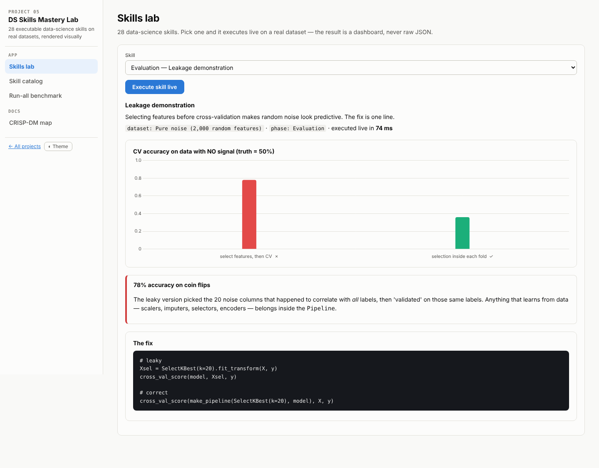
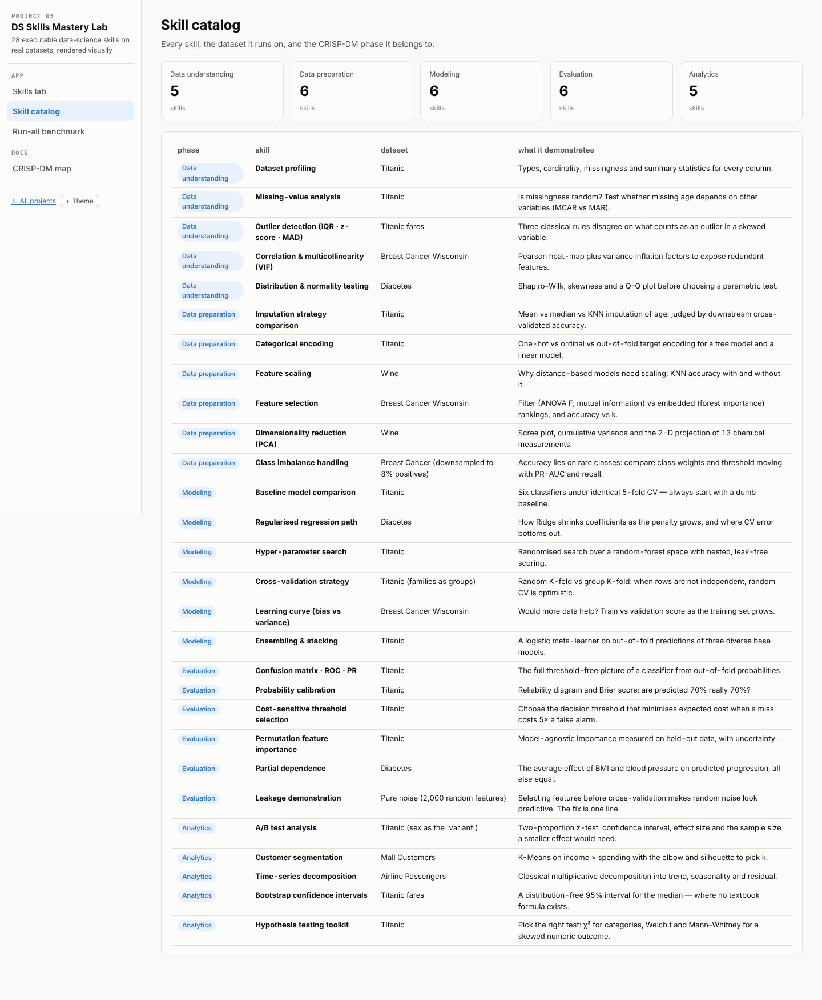
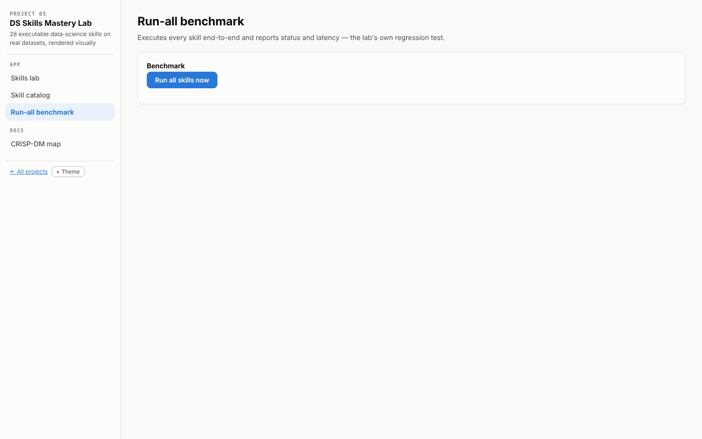
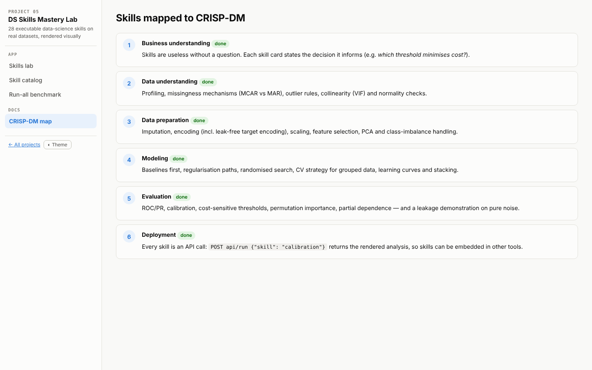

# Project 05 — DS Skills Mastery Lab

> 28 executable data-science skills on real datasets, rendered visually

**Walkthrough video (2 min):** _add link in `videos.json`_

## What it is
A lab of 28 executable data-science skills, each a function that runs live on a real dataset (Titanic, Breast Cancer, Wine, Diabetes, Mall Customers, Airline Passengers) and renders a visual dashboard — never raw JSON.

## Run it
```bash
# from the repository root
python run.py 05          # → http://127.0.0.1:8005
python run.py             # or the hub with all 16 projects → http://127.0.0.1:8000
```

## Results
- 28 skills across data understanding (5), preparation (6), modeling (6), evaluation (6) and analytics (5).
- All 28 pass the run-all benchmark; each is also an API call (`POST api/run`).

## What I added beyond the reference prompt
- I wrote the skills as an in-repo registry (`skills.py`) instead of installing third-party skill packs, so every skill is readable, runnable and tested here.
- A run-all benchmark that executes every skill and reports status and latency.
- A leakage demonstration on pure noise: selecting features before cross-validation yields high accuracy on random labels; one line fixes it.
- Skills mapped to CRISP-DM phases.

## Pages
- **Skills lab** (App)
- **Skill catalog** (App)
- **Run-all benchmark** (App)
- **CRISP-DM map** (Docs)

## Code map
- `skills.py` — the 28 skills and the `@skill` registry
- `app.py` — lab, catalog, run-all benchmark
- `../common/` — shared app factory, UI kit (`kit/kit.js`), AutoResearch hill-climber, static auditor

## Prompt this project replicates
```text
/teamwork-preview install param087 github agent-ml-skills and install nimrodfisher data-analytics-skills and demonstrate every skill on appropriate popular kaggle data set. also include crisp-dm steps in it.
```

## Screenshot tour
### Lab


### Catalog


### Bench


### Crispdm


