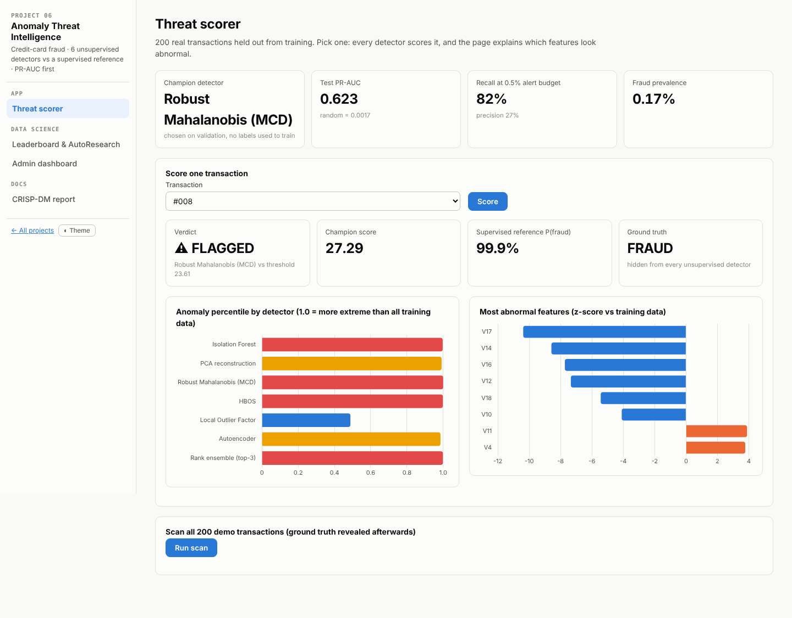
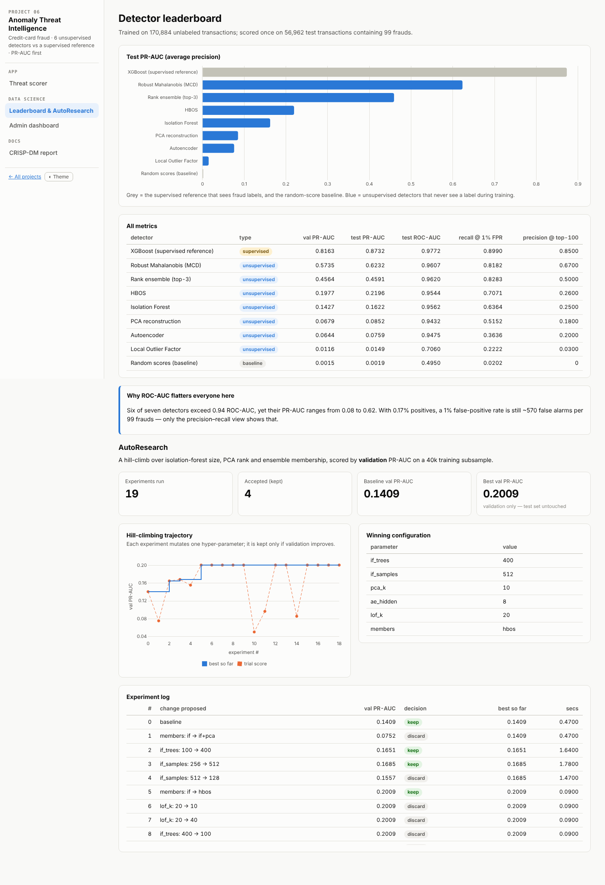
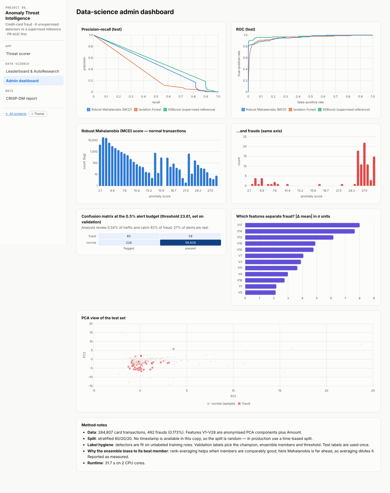
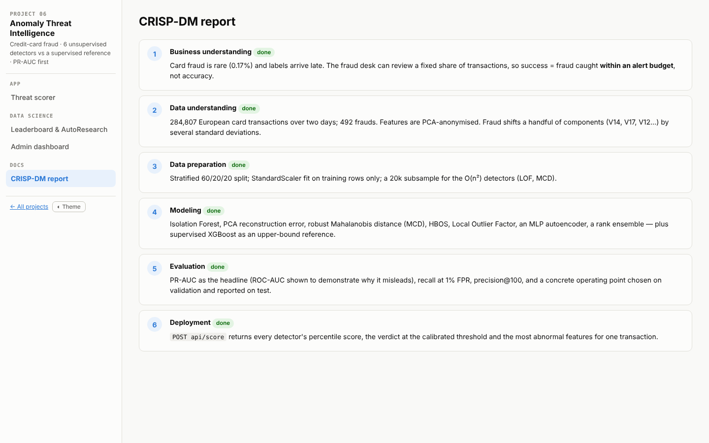

# Project 06 — Anomaly Threat Intelligence

> Credit-card fraud · 6 unsupervised detectors vs a supervised reference · PR-AUC first

**Walkthrough video (2 min):** _add link in `videos.json`_

## What it is
Fraud detection on the Kaggle Credit Card Fraud dataset (284,807 transactions, 0.17% fraud): six unsupervised detectors trained without labels, a rank ensemble, and a supervised XGBoost reference, with a live transaction scorer.

## Run it
```bash
# from the repository root
python run.py 06          # → http://127.0.0.1:8006
python run.py             # or the hub with all 16 projects → http://127.0.0.1:8000
python run.py train 06    # re-run the training pipeline and rebuild artifacts/
```

## Results (read from `artifacts/metrics.json` by `scripts/build_docs.py`)
- Split 170,884 / 56,961 / 56,962; 99 frauds in test.
- Test PR-AUC — XGBoost (supervised reference): 0.873; Robust Mahalanobis (MCD): 0.623; Rank ensemble (top-3): 0.459; HBOS: 0.220.
- Champion (chosen on validation): **Robust Mahalanobis (MCD)**. At a 0.54% alert rate it catches **82%** of fraud with 27% precision.
- Limit: this copy of the data has no timestamp, so the split is stratified random; production should split by time. The 46 MB dataset is downloaded on first training run, not stored in the repo.

## What I added beyond the reference prompt
- PR-AUC is the headline metric; the dashboard shows why ROC-AUC flatters every detector at this imbalance.
- An operating point: threshold set on validation for a 0.5% alert budget, then reported on test as precision / recall and a confusion matrix.
- A supervised reference model to show the gap unsupervised methods leave.
- Reports as measured that the ensemble *loses* to its best member, and explains why.

## Pages
- **Threat scorer** (App)
- **Leaderboard & AutoResearch** (Data science)
- **Admin dashboard** (Data science)
- **CRISP-DM report** (Docs)

## Code map
- `pipeline.py` — detectors, HBOS, AutoResearch, leaderboard, operating point
- `app.py` — `POST api/score`, `POST api/scan`, dashboards
- `../common/` — shared app factory, UI kit (`kit/kit.js`), AutoResearch hill-climber, static auditor

## Prompt this project replicates
```text
/teamwork-preview Now lets do another project - anomaly detection using popular kaggle data set and popular methods - make sure you follow crisp-dm framework and also include nice data science admin dashboard. you can research the papers and implement autoresearch to do hill climbing and match the dashboard details with research paper. include all details a data scientist and ai engineer will care.
```

## Screenshot tour
### Scorer


### Leaderboard


### Admin


### Crispdm


