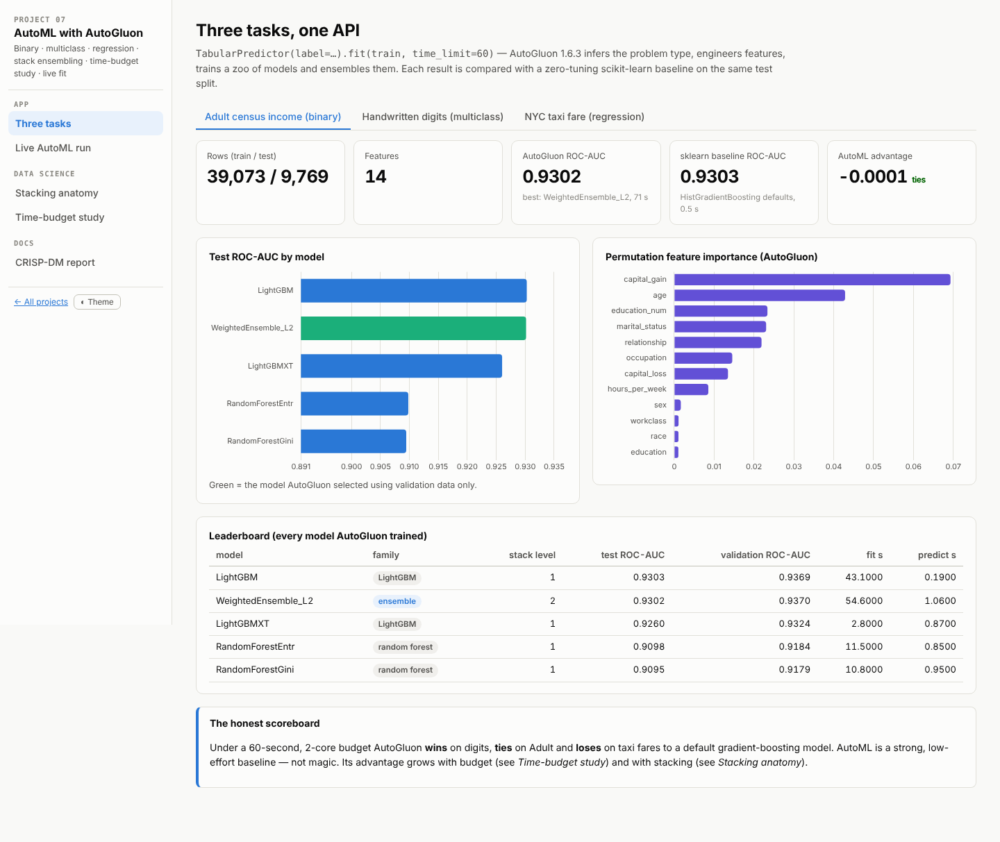
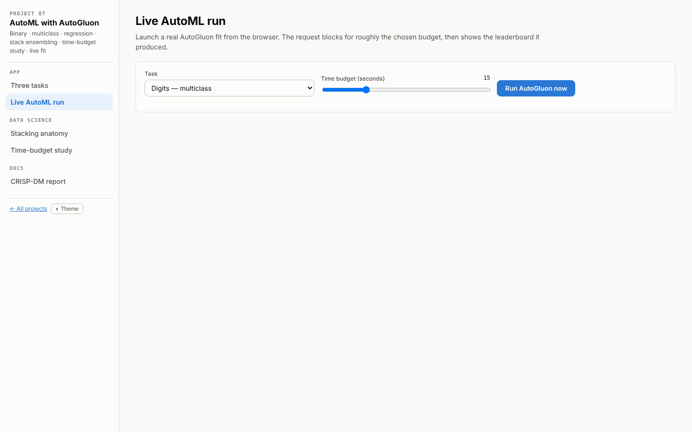
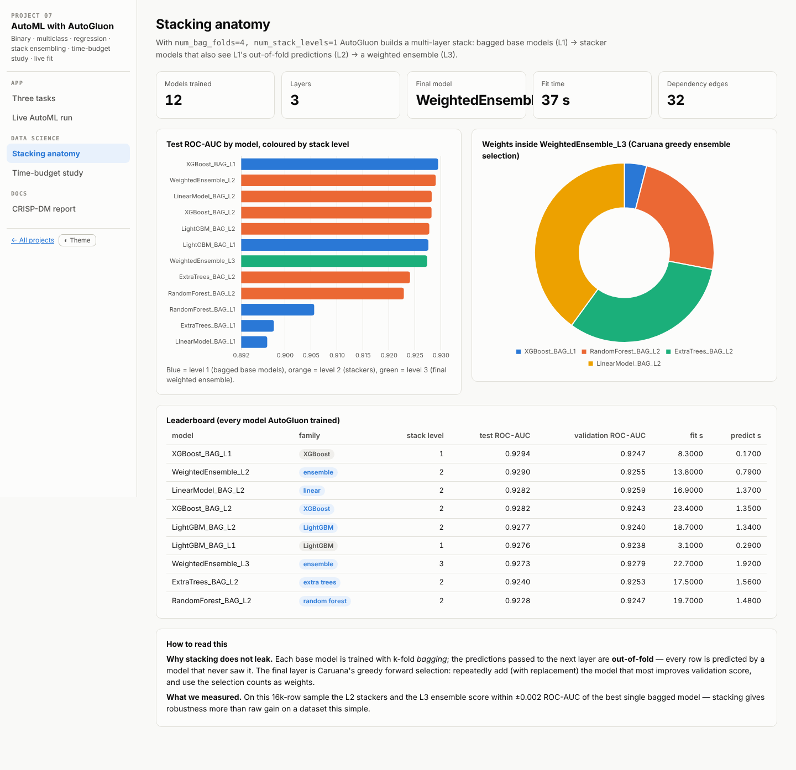
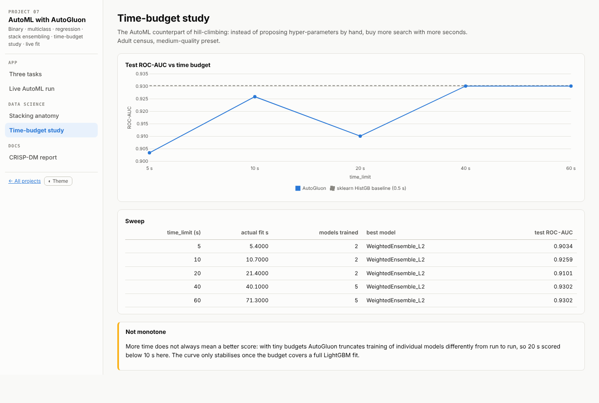
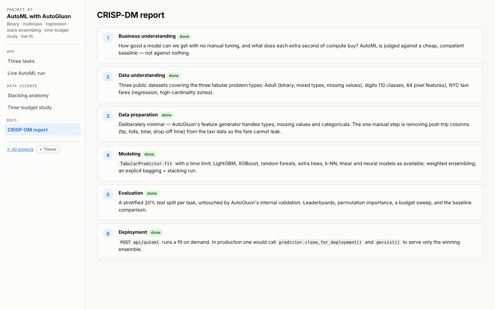

# Project 07 — AutoML with AutoGluon

> Binary · multiclass · regression · stack ensembling · time-budget study · live fit

**Walkthrough video (2 min):** _add link in `videos.json`_

## What it is
AutoGluon on three task types — binary (Adult income), multiclass (digits) and regression (NYC taxi fare) — each compared with a zero-tuning scikit-learn baseline, plus a stack-ensembling anatomy, a time-budget study and a live AutoML run from the browser.

## Run it
```bash
# from the repository root
python run.py 07          # → http://127.0.0.1:8007
python run.py             # or the hub with all 16 projects → http://127.0.0.1:8000
python run.py train 07    # re-run the training pipeline and rebuild artifacts/
```

## Results (read from `artifacts/metrics.json` by `scripts/build_docs.py`)
- Adult census income: AutoGluon 0.9302 vs baseline 0.9303 (ROC-AUC)
- Handwritten digits: AutoGluon 0.9778 vs baseline 0.9583 (accuracy)
- NYC taxi fare: AutoGluon -3.5719 vs baseline -3.4468 (−RMSE ($))
- Stack: 12 models over 3 levels, final `WeightedEnsemble_L3`.
- Honest finding: with a 60-second budget on 2 CPU cores AutoGluon wins on digits, ties on Adult and loses on taxi fares to default gradient boosting.
- Limit: fitted AutoGluon models (hundreds of MB) are not stored in the repo; `python run.py train 07` rebuilds them.

## What I added beyond the reference prompt
- Every AutoML result sits next to an honest baseline on the same test split — including the cases where AutoML ties or loses.
- A live `POST api/automl` endpoint that launches a real AutoGluon fit with a chosen time budget.
- Stacking anatomy: bagged L1 models, L2 stackers, L3 weighted ensemble with its Caruana weights.
- Time-budget sweep as the AutoML analogue of hill-climbing.

## Pages
- **Three tasks** (App)
- **Live AutoML run** (App)
- **Stacking anatomy** (Data science)
- **Time-budget study** (Data science)
- **CRISP-DM report** (Docs)

## Code map
- `pipeline.py` — three tasks, baselines, stacking study, budget sweep
- `app.py` — dashboards and the live AutoML endpoint
- `../common/` — shared app factory, UI kit (`kit/kit.js`), AutoResearch hill-climber, static auditor

## Prompt this project replicates
```text
/teamwork-preview Now lets do another project - illustrate automl with autogluon on various data science tasks - make sure you follow crisp-dm framework and also include nice data science admin dashboard. you can research the papers and implement autoresearch to do hill climbing and match the dashboard details with research paper. include all details a data scientist and ai engineer will care.
```

## Screenshot tour
### Tasks


### Live


### Stack


### Budget


### Crispdm


