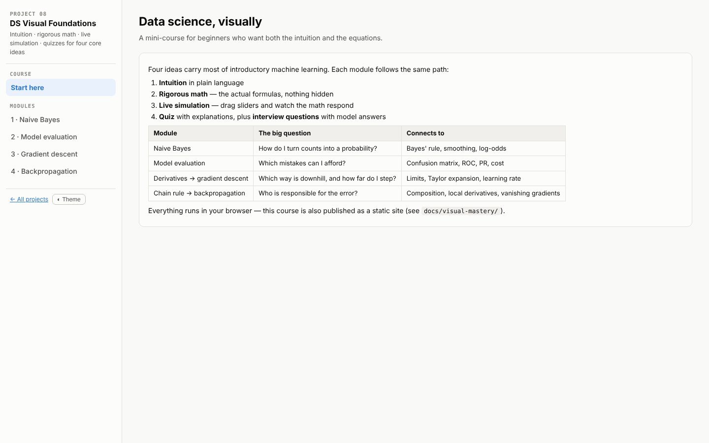
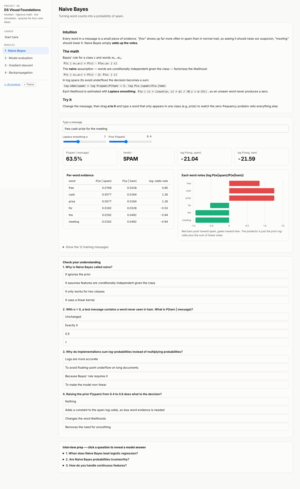
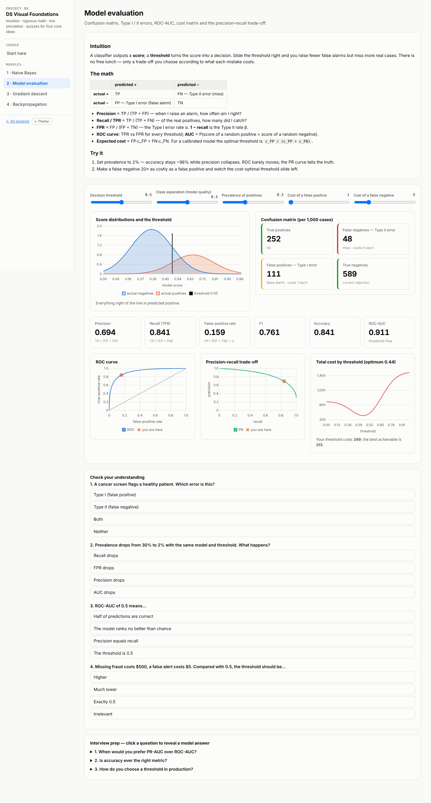
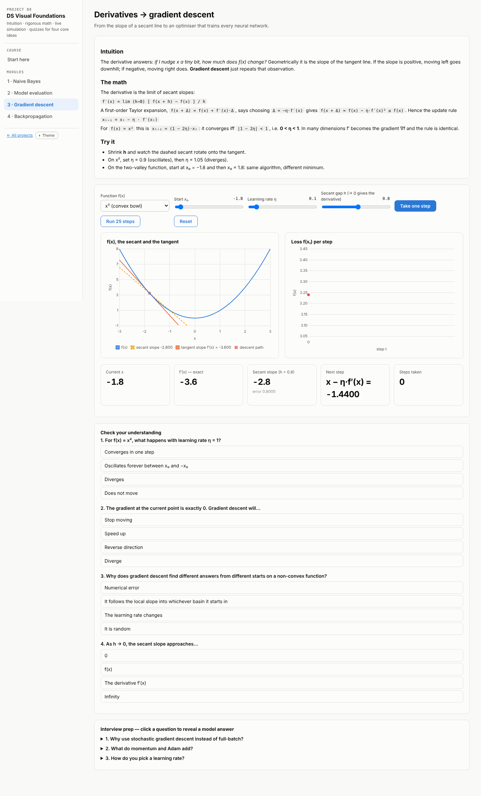
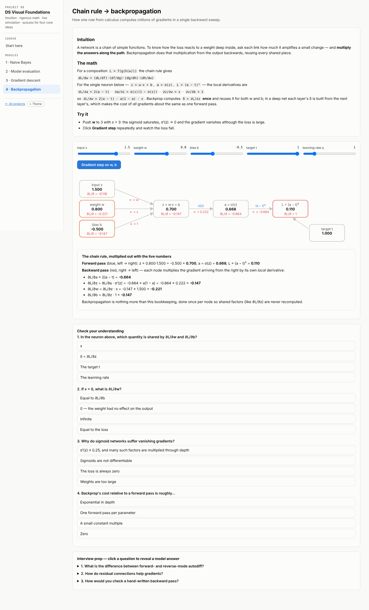

# Project 08 — DS Visual Foundations

> Intuition · rigorous math · live simulation · quizzes for four core ideas

**Walkthrough video (2 min):** _add link in `videos.json`_

## What it is
A four-module visual course. Each module has intuition, the actual math, a live simulator, a graded quiz with explanations, and interview questions with model answers. A static export is published for GitHub Pages.

## Run it
```bash
# from the repository root
python run.py 08          # → http://127.0.0.1:8008
python run.py             # or the hub with all 16 projects → http://127.0.0.1:8000
```

## Results
- 4 modules, 16 quiz questions, 12 interview questions.
- GitHub Pages: enable Pages on the `/docs` folder; the course is at `/visual-mastery/`.

## What I added beyond the reference prompt
- All four simulators run in the browser, so the whole course exports to a static site (`docs/visual-mastery/`).
- The evaluation simulator links threshold, confusion matrix, ROC, PR and a cost curve in one view.
- The backprop simulator draws the computation graph with live forward values and gradients and multiplies the chain rule out with the current numbers.
- Failure modes are built in: zero-frequency problem (α = 0), divergence (η > 1), vanishing gradient (saturated sigmoid).

## Pages
- **Start here** (Course)
- **1 · Naive Bayes** (Modules)
- **2 · Model evaluation** (Modules)
- **3 · Gradient descent** (Modules)
- **4 · Backpropagation** (Modules)

## Code map
- `app.py` — lessons, quizzes, interview answers
- `web/custom.js` — the four simulators
- `export_static.py` — GitHub Pages export
- `../common/` — shared app factory, UI kit (`kit/kit.js`), AutoResearch hill-climber, static auditor

## Prompt this project replicates
```text
/teamwork-preview lets do another project - teach beginner data science students in an excellent way with deep intuition and rigorous math and visual intuition and live simulation on:
1. naive bayes
2. evaluation of model - confusion matrix, type 1 and type 2 errors, roc-auc, cost matrix, tradeoff between precision and recall
3. differential calculus, derivatives and how they connect to gradient descent
4. chain rule and how it connects to backpropagation
include quizzes for each concept and interview prep questions. also create a github.io ready page for this project.
```

## Screenshot tour
### Home


### Naive Bayes


### Evaluation


### Gradient Descent


### Backprop


