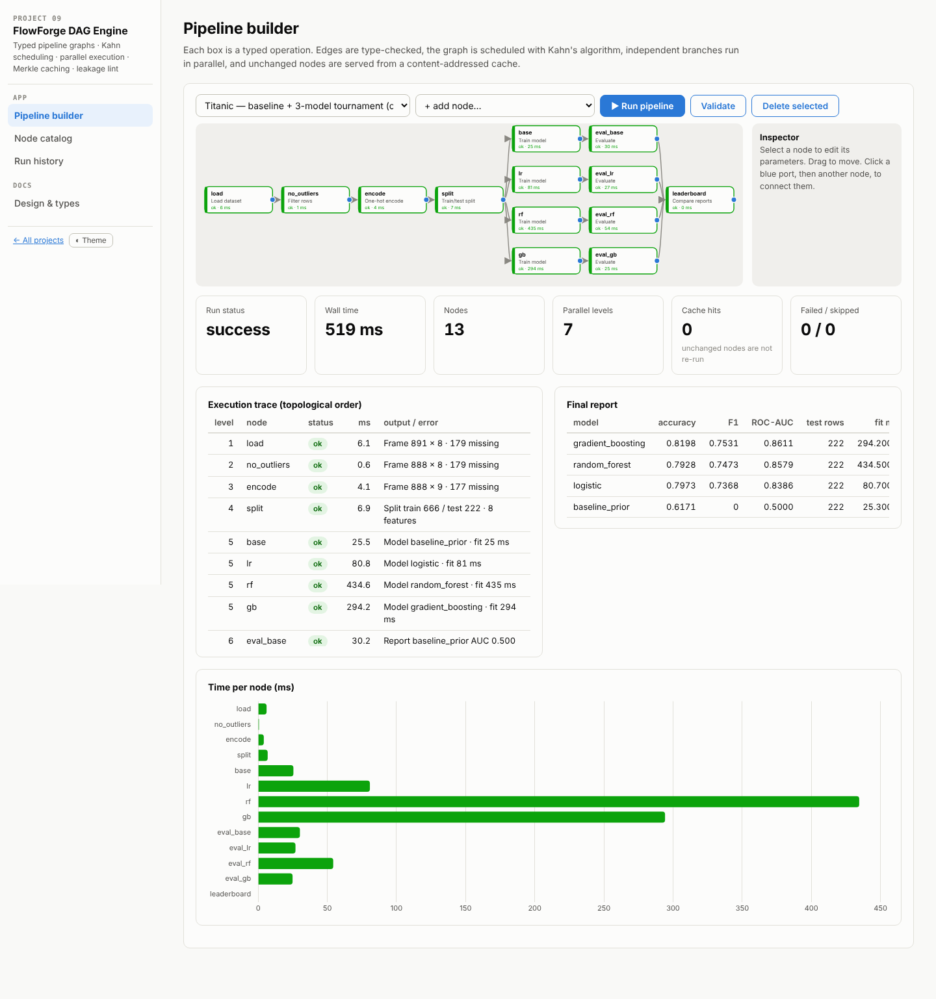
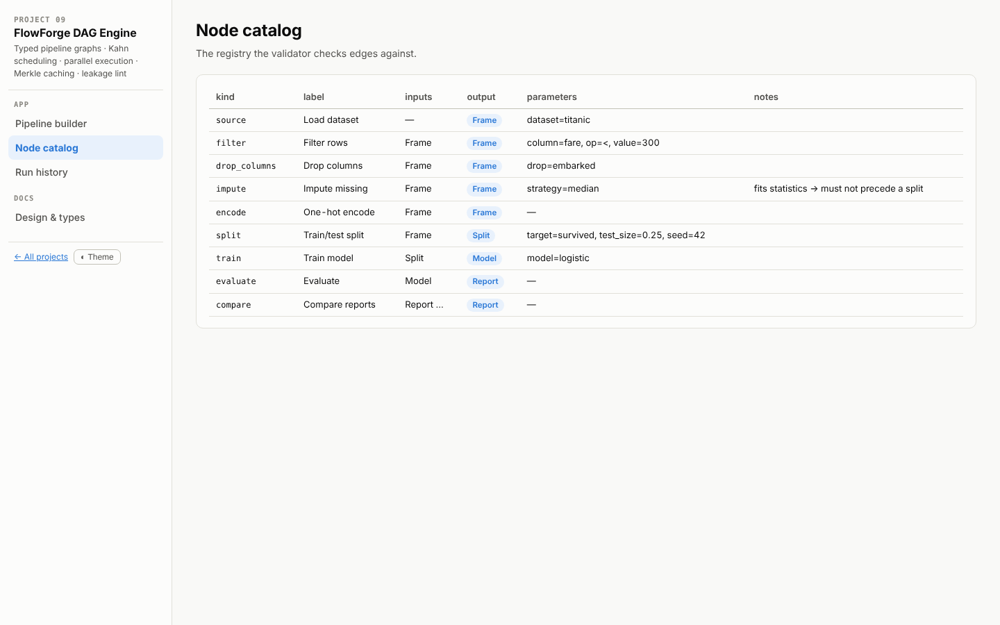
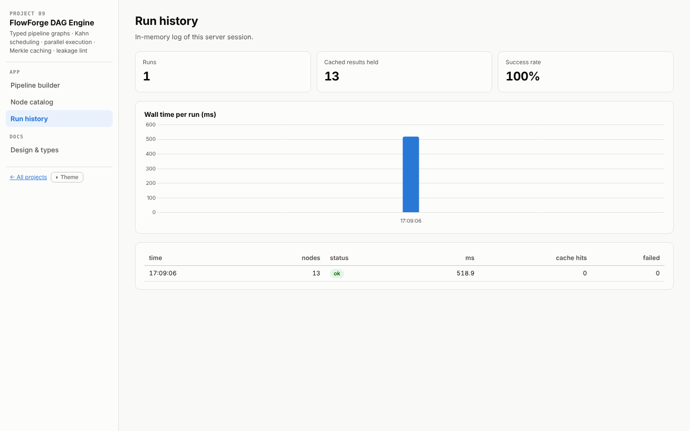
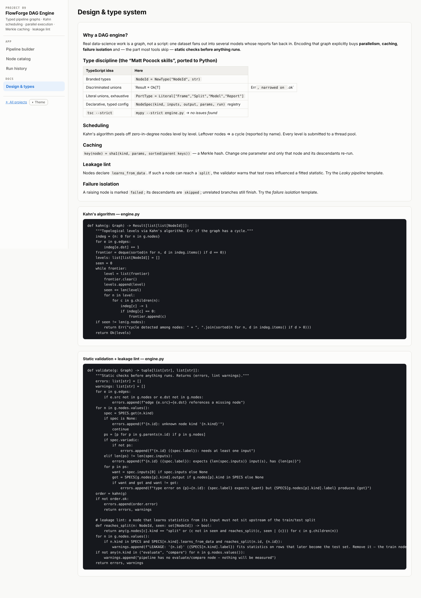

# Project 09 — FlowForge DAG Engine

> Typed pipeline graphs · Kahn scheduling · parallel execution · Merkle caching · leakage lint

**Walkthrough video (2 min):** _add link in `videos.json`_

## What it is
FlowForge: a visual, type-checked DAG engine for data-science pipelines. Kahn's algorithm schedules the graph, independent branches run in parallel, results are cached by content hash, failures are isolated, and a lint warns about leakage before anything runs.

## Run it
```bash
# from the repository root
python run.py 09          # → http://127.0.0.1:8009
python run.py             # or the hub with all 16 projects → http://127.0.0.1:8000
```

## Results
- 9 node kinds over 4 port types (Frame, Split, Model, Report).
- `mypy --strict engine.py` → no issues.
- Template 1 runs 13 nodes in 7 parallel levels; an unchanged re-run is served entirely from cache.

## What I added beyond the reference prompt
- The reference demonstrated TypeScript type discipline; I ported the same ideas to typed Python — branded ids (`NewType`), a `Result = Ok | Err` union, literal types, a typed node registry — and the engine passes `mypy --strict`.
- A leakage lint: nodes declare `learns_from_data`; placing one upstream of a split raises a warning.
- Merkle-style caching: change one parameter and only that node and its descendants re-run.
- Drag-and-drop canvas with templates for a clean run, a leaky pipeline, a type error + cycle, and failure isolation.

## Pages
- **Pipeline builder** (App)
- **Node catalog** (App)
- **Run history** (App)
- **Design & types** (Docs)

## Code map
- `engine.py` — types, node registry, Kahn scheduler, validator + lint, executor
- `app.py` — `POST api/run`, `POST api/validate`
- `web/custom.js` — the canvas editor
- `../common/` — shared app factory, UI kit (`kit/kit.js`), AutoResearch hill-climber, static auditor

## Prompt this project replicates
```text
/teamwork-preview install matt pocock skills and then demonstrate it with a complicated end2end full stack project
```

## Screenshot tour
### Builder


### Catalog


### Runs


### Design


