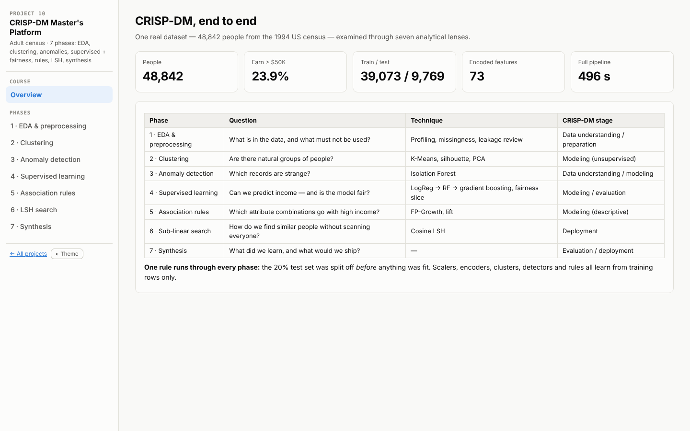
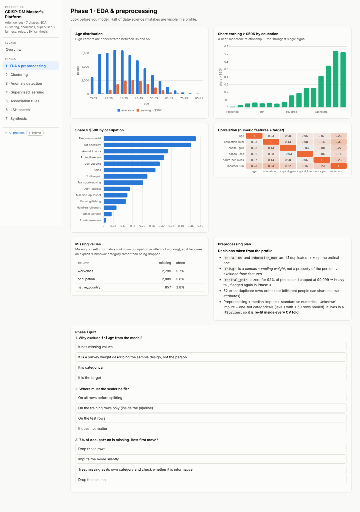
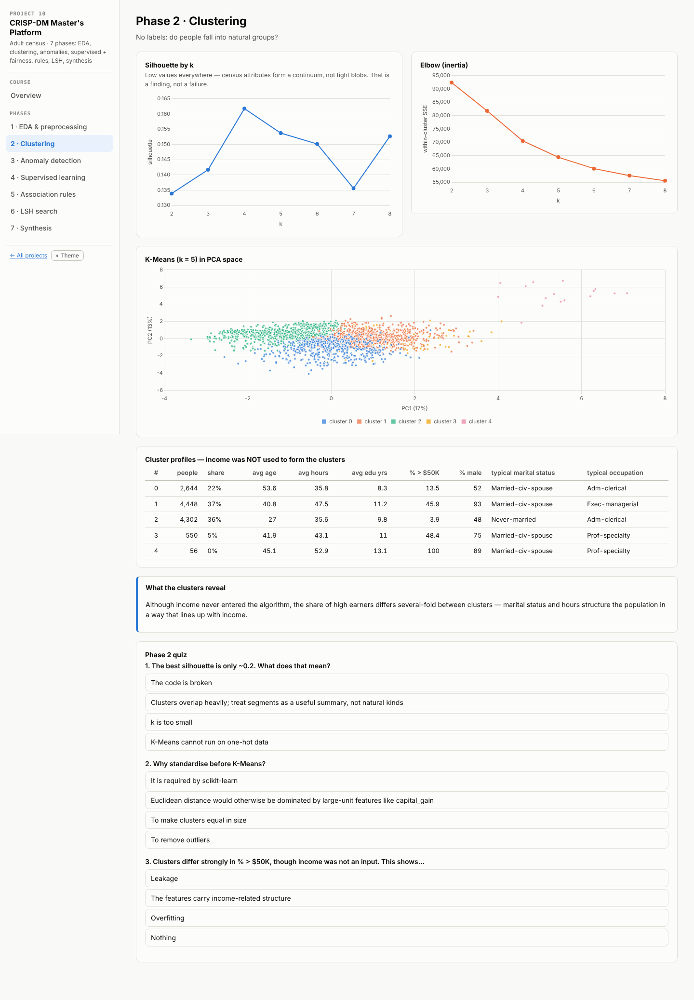
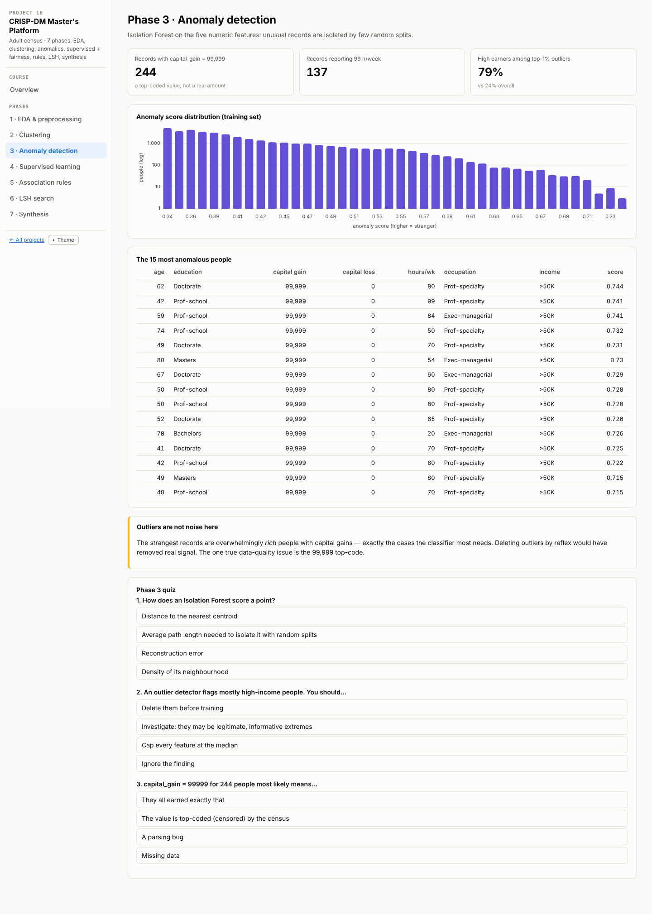
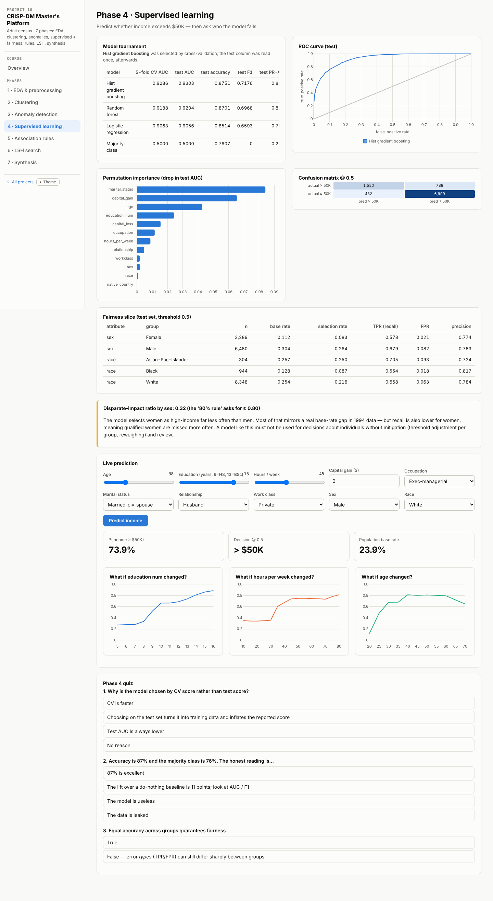
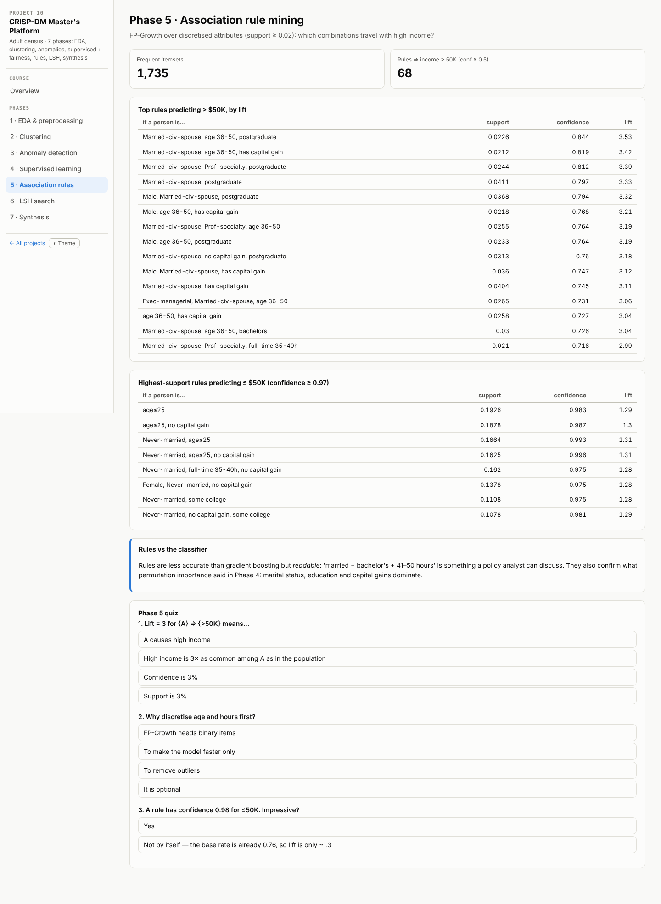
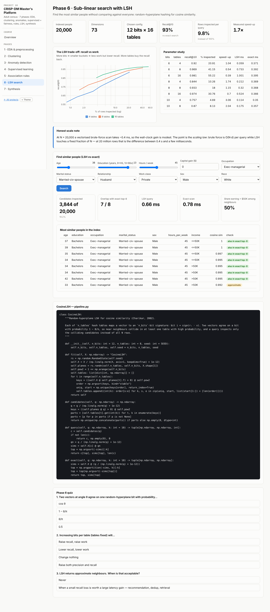
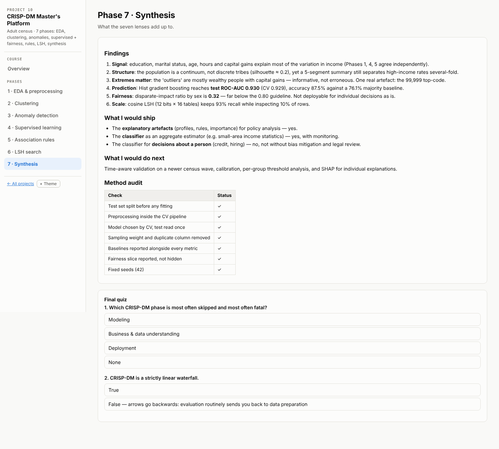

# Project 10 — CRISP-DM Master's Platform

> Adult census · 7 phases: EDA, clustering, anomalies, supervised + fairness, rules, LSH, synthesis

**Walkthrough video (2 min):** _add link in `videos.json`_

## What it is
A seven-phase course on one dataset (Adult census, 48,842 people): EDA & preprocessing, clustering, anomaly detection, supervised learning, association rules, cosine LSH and synthesis — each with results, a lesson and a quiz.

## Run it
```bash
# from the repository root
python run.py 10          # → http://127.0.0.1:8010
python run.py             # or the hub with all 16 projects → http://127.0.0.1:8000
python run.py train 10    # re-run the training pipeline and rebuild artifacts/
```

## Results (read from `artifacts/metrics.json` by `scripts/build_docs.py`)
- Supervised: **Hist gradient boosting** — test ROC-AUC 0.9303, accuracy 87.5% (majority baseline 76.1%).
- Fairness: disparate-impact ratio by sex **0.32** (the 80% rule asks for ≥ 0.80).
- Anomalies: 79% of the top-1% outliers are high earners (vs 24% overall).
- LSH (12 bits × 16 tables): recall@10 93% while inspecting 9.8% of rows; measured speed-up 1.7× at N = 20,000.
- Rules: 68 rules predicting >50K.

## What I added beyond the reference prompt
- A fairness slice on the classifier (selection rate, TPR, FPR by sex and race) and the disparate-impact ratio, with a clear statement of what should not be shipped.
- A from-scratch cosine LSH with a recall-vs-work parameter study and a live LSH-vs-exact search.
- The test set is split off before anything is fitted; preprocessing is re-fit inside every CV fold.
- A method-audit checklist in the synthesis.

## Pages
- **Overview** (Course)
- **1 · EDA & preprocessing** (Phases)
- **2 · Clustering** (Phases)
- **3 · Anomaly detection** (Phases)
- **4 · Supervised learning** (Phases)
- **5 · Association rules** (Phases)
- **6 · LSH search** (Phases)
- **7 · Synthesis** (Phases)

## Code map
- `pipeline.py` — all seven phases and the `CosineLSH` class
- `app.py` — lessons, quizzes, `POST api/predict`, `POST api/similar`
- `../common/` — shared app factory, UI kit (`kit/kit.js`), AutoResearch hill-climber, static auditor

## Prompt this project replicates
```text
/teamwork-preview As an industry expert data scientist and expert in CRISP-DM methodology for data science projects, build an end to end data science project based on a popular kaggle dataset that takes a user through all aspects and nuances of the crisp-dm steps in textbook quality.
The project must include:
1. data science quizzes for each concept
2. exploratory data analysis and data preprocessing
3. unsupervised machine learning (clustering)
4. anomaly/outlier detection
5. supervised machine learning
6. associative rule mining
7. sub-linear search (lsh)
8. a clean conclusion/synthesis phase
```

## Screenshot tour
### Overview


### Eda


### Clustering


### Anomaly


### Supervised


### Rules


### Lsh


### Synthesis


