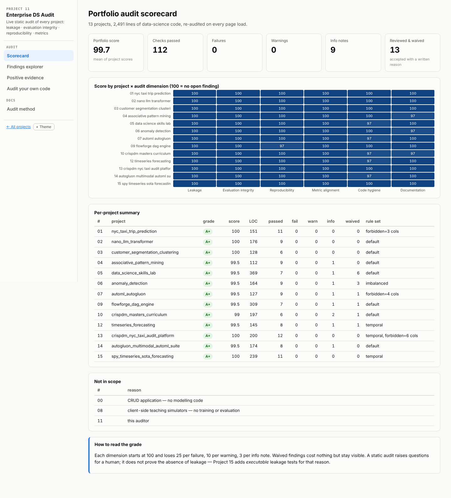
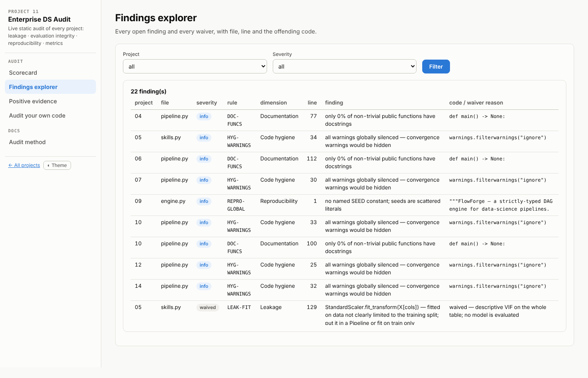
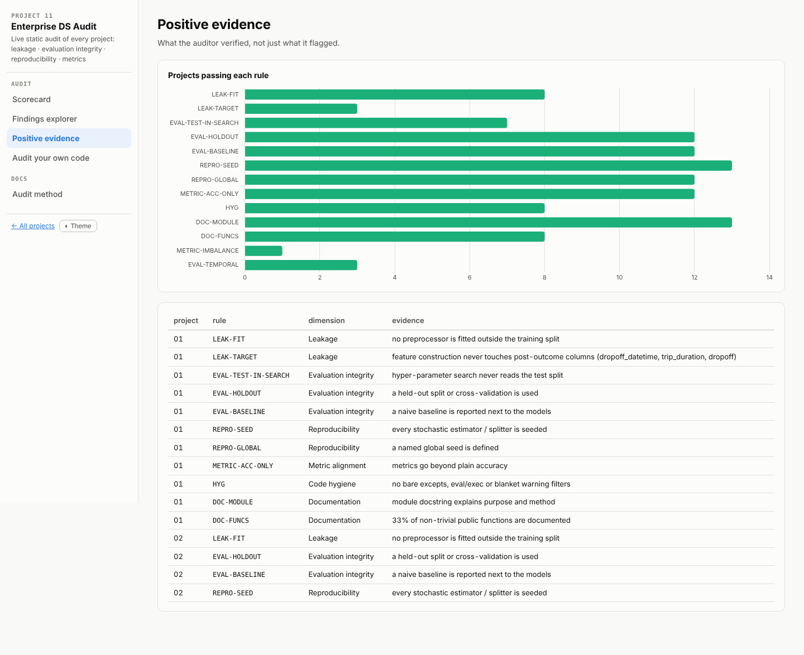
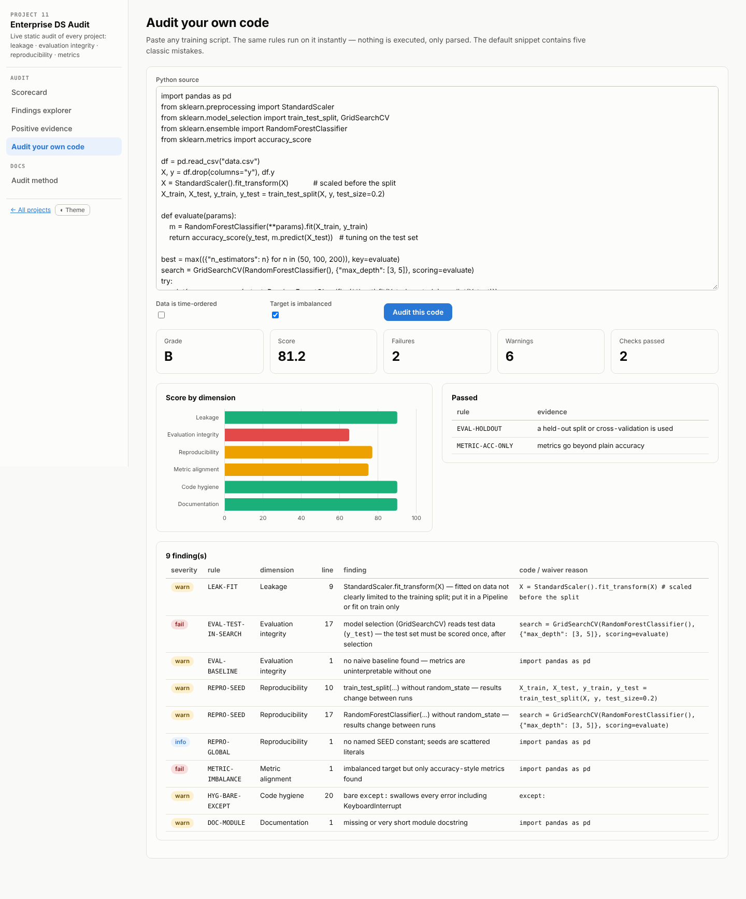
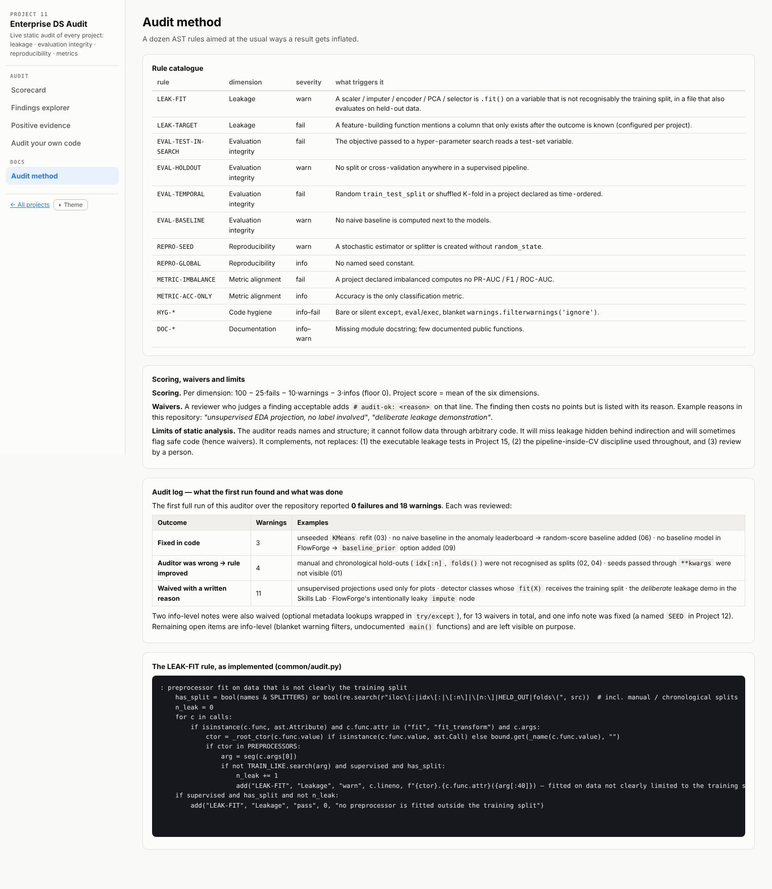

# Project 11 — Enterprise DS Audit

> Live static audit of every project: leakage · evaluation integrity · reproducibility · metrics

**Walkthrough video (2 min):** _add link in `videos.json`_

## What it is
A static (AST) data-science code auditor that re-audits every other project on each page load across six dimensions — leakage, evaluation integrity, reproducibility, metric alignment, hygiene, documentation — plus a page where you paste your own code and get it audited.

## Run it
```bash
# from the repository root
python run.py 11          # → http://127.0.0.1:8011
python run.py             # or the hub with all 16 projects → http://127.0.0.1:8000
```

## Results
- 13 projects audited (00, 08 and 11 are out of scope and listed as such).
- First run: 0 failures, 18 warnings → 3 fixed in code, 4 were auditor false positives (rule improved), 11 waived with written reasons.
- Remaining open items are info-level and left visible.
- Limit: static analysis is heuristic; Project 15 adds executable leakage tests.

## What I added beyond the reference prompt
- The report is live: it parses the current source files, so it cannot drift from the code.
- Waivers are explicit: an accepted finding carries `# audit-ok: reason` in the source and stays listed with its reason.
- A paste-your-code auditor with a deliberately leaky default snippet.
- An audit log of what the first run found and how each finding was fixed, waived or shown to be a false positive.

## Pages
- **Scorecard** (Audit)
- **Findings explorer** (Audit)
- **Positive evidence** (Audit)
- **Audit your own code** (Audit)
- **Audit method** (Docs)

## Code map
- `common/audit.py` — the rules
- `11_enterprise_ds_audit/app.py` — project configuration and report pages
- `../common/` — shared app factory, UI kit (`kit/kit.js`), AutoResearch hill-climber, static auditor

## Prompt this project replicates
```text
/teamwork-preview do a advanced data science audit for all the projects and provide detailed report in the website
```

## Screenshot tour
### Scorecard


### Findings


### Evidence


### Live


### Method


