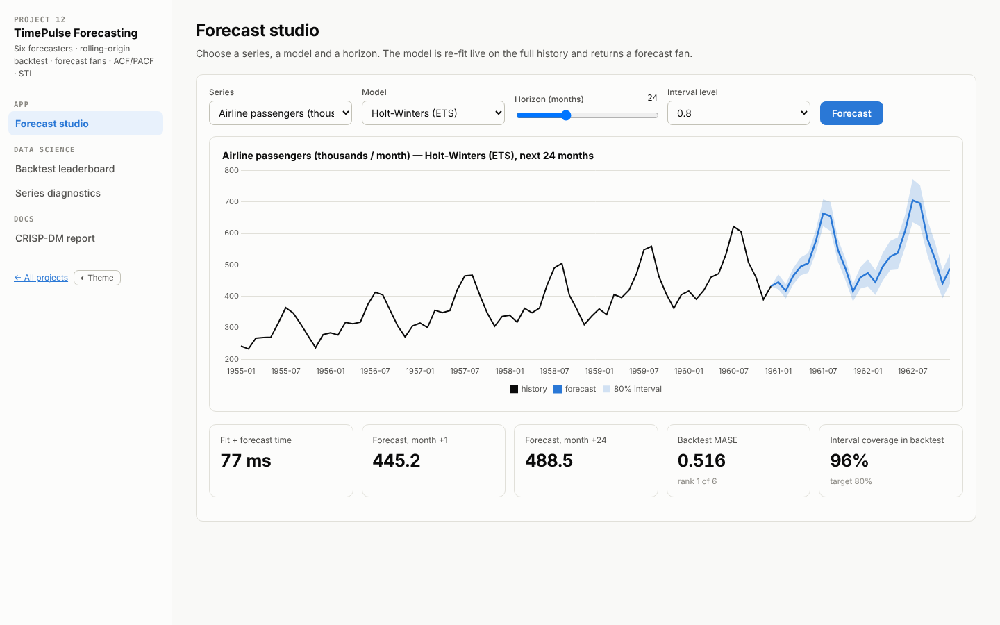
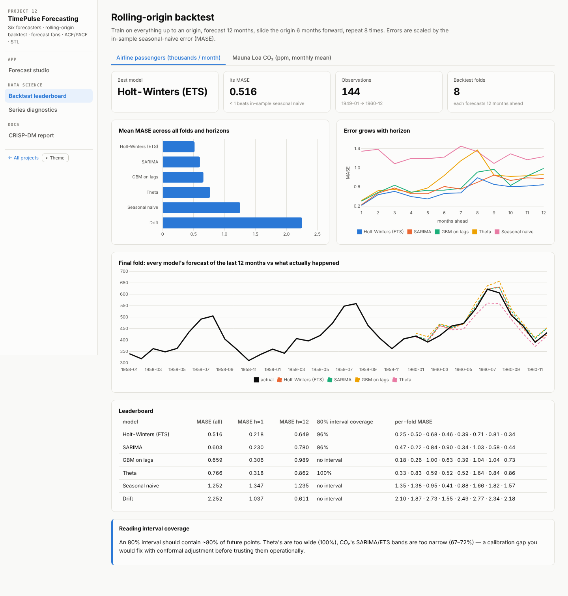
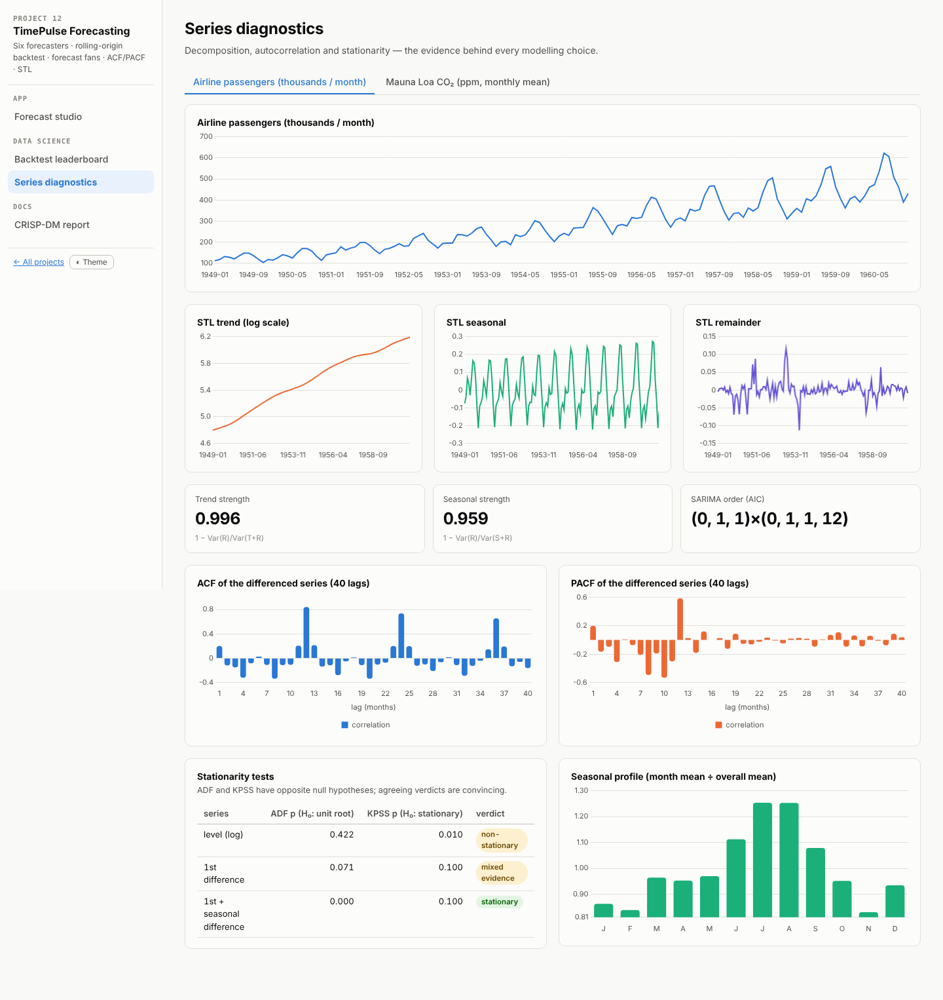
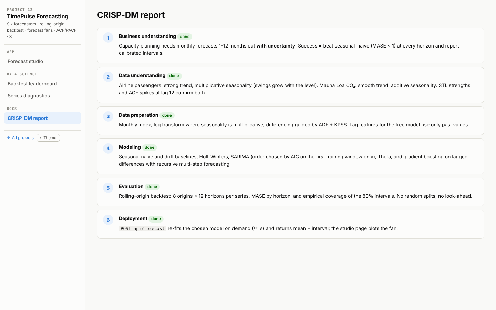

# Project 12 — TimePulse Forecasting

> Six forecasters · rolling-origin backtest · forecast fans · ACF/PACF · STL

**Walkthrough video (2 min):** _add link in `videos.json`_

## What it is
TimePulse: six forecasters (seasonal naive, drift, Holt-Winters, SARIMA, Theta, gradient boosting on lags) on two real monthly series, evaluated with a rolling-origin backtest, with forecast fans, STL decomposition, 40-lag ACF/PACF and stationarity tests.

## Run it
```bash
# from the repository root
python run.py 12          # → http://127.0.0.1:8012
python run.py             # or the hub with all 16 projects → http://127.0.0.1:8000
python run.py train 12    # re-run the training pipeline and rebuild artifacts/
```

## Results (read from `artifacts/metrics.json` by `scripts/build_docs.py`)
- Airline passengers (thousands / month): best **Holt-Winters (ETS)** (MASE 0.516); seasonal naive 1.252.
- Mauna Loa CO₂ (ppm, monthly mean): best **Holt-Winters (ETS)** (MASE 0.409); seasonal naive 1.397.
- Interval coverage is reported per model: some bands are too wide (Theta 100%), some too narrow (CO₂ SARIMA/ETS ≈ 67–72%).

## What I added beyond the reference prompt
- Rolling-origin backtest (8 origins × 12 horizons) with MASE by horizon — no random splits anywhere.
- Empirical coverage of every model's 80% interval, including the cases where it is miscalibrated.
- Live re-fit: the forecast studio fits the chosen model on demand.

## Pages
- **Forecast studio** (App)
- **Backtest leaderboard** (Data science)
- **Series diagnostics** (Data science)
- **CRISP-DM report** (Docs)

## Code map
- `pipeline.py` — forecasters, rolling-origin backtest, diagnostics
- `app.py` — `POST api/forecast`, backtest and diagnostics pages
- `../common/` — shared app factory, UI kit (`kit/kit.js`), AutoResearch hill-climber, static auditor

## Prompt this project replicates
```text
/teamwork-preview build a similar website in directory timeseries_test for timeseries forcasting similar to other projects you built - including detailed crisp-dm steps and admin and other dashboards
```

## Screenshot tour
### Studio


### Backtest


### Diagnostics


### Crispdm


