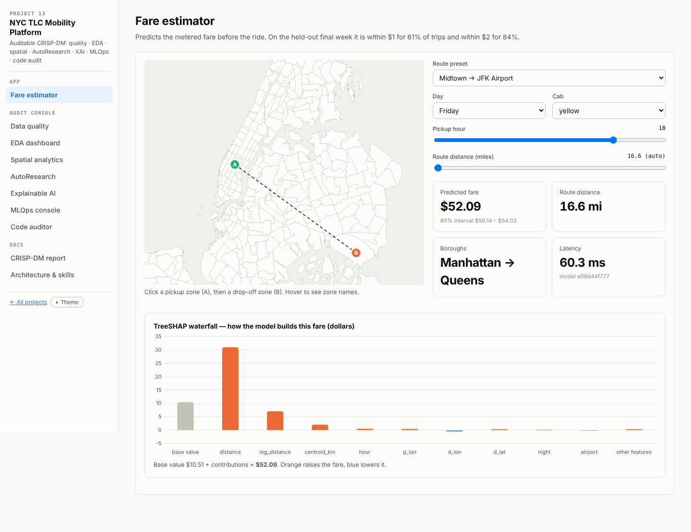
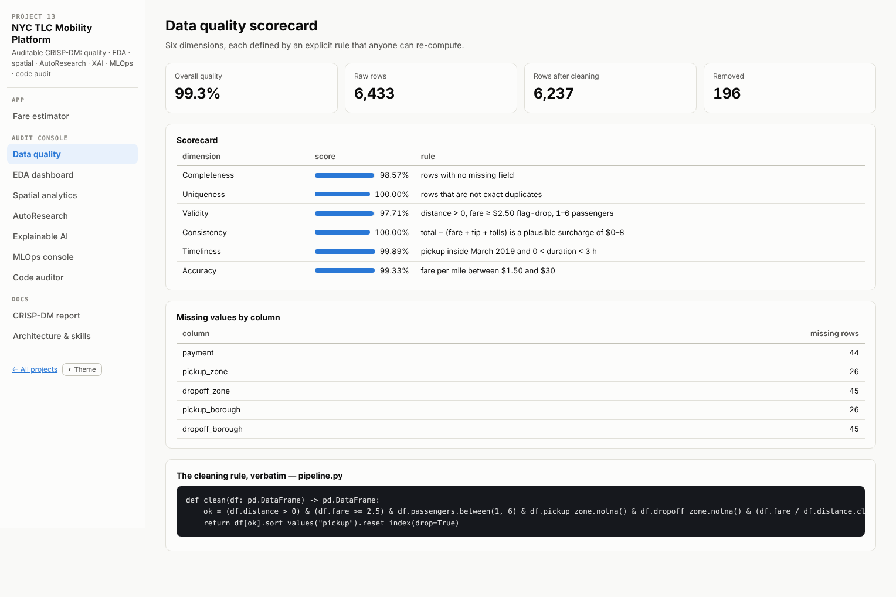
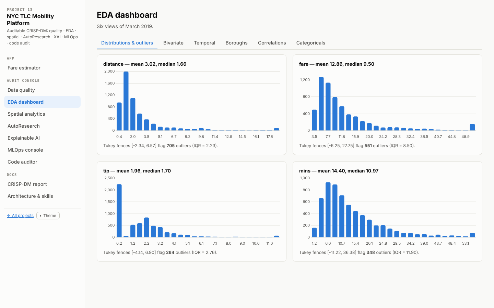
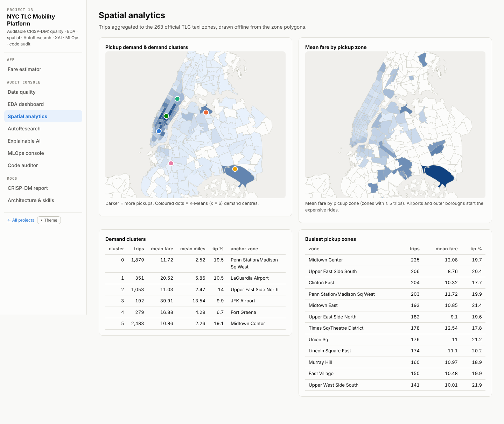
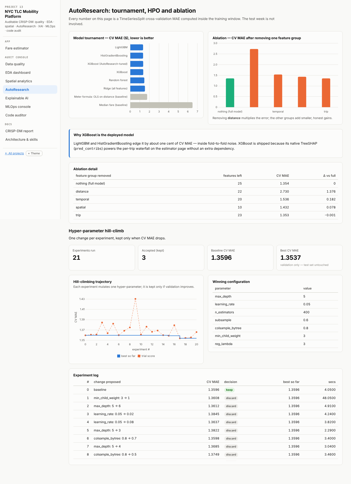
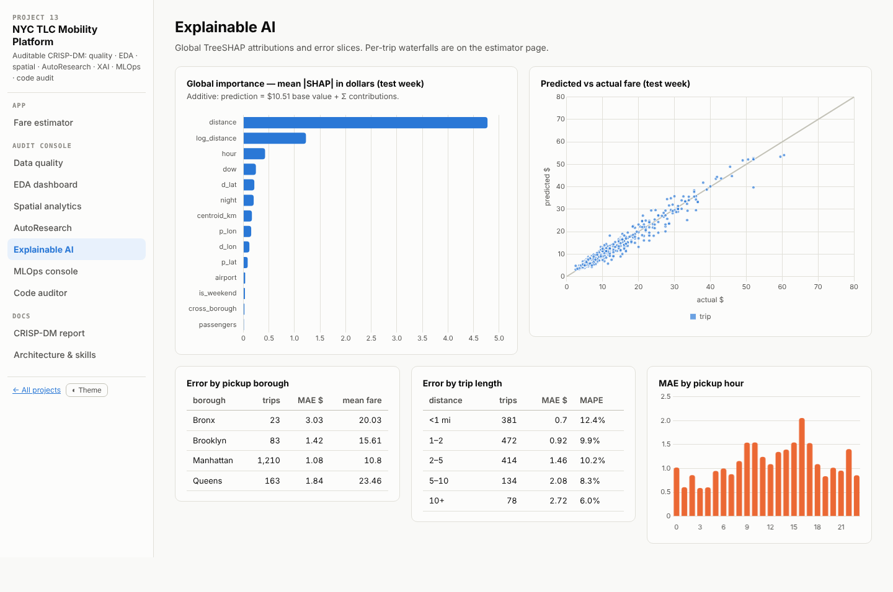
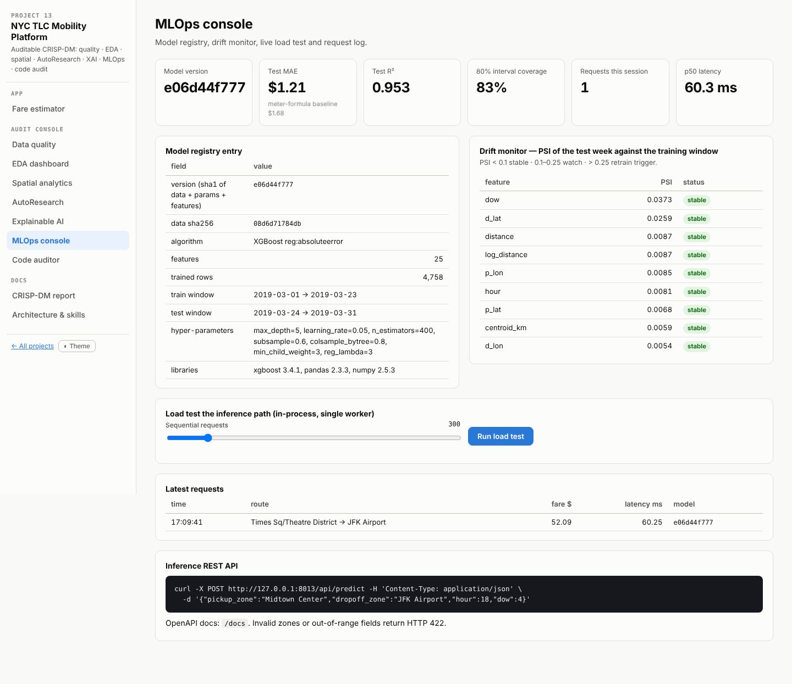
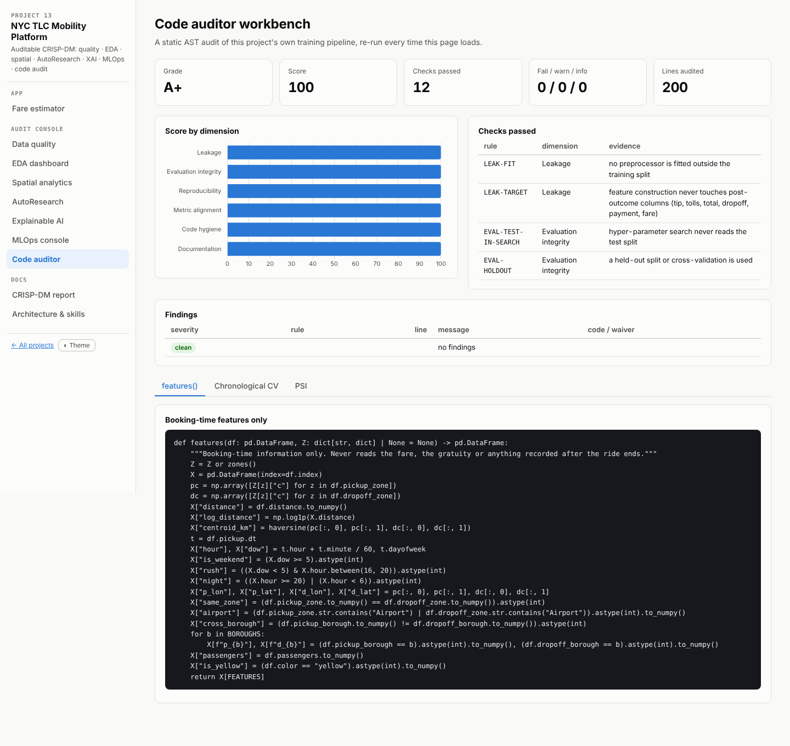
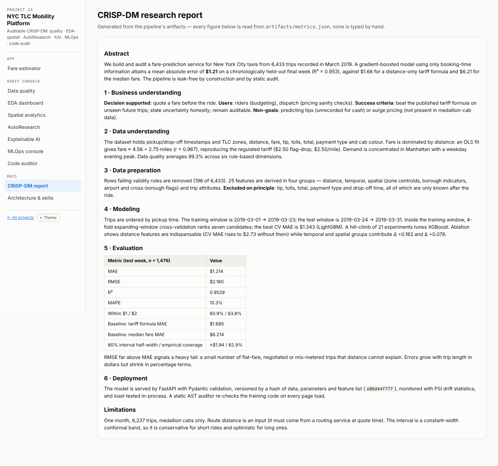
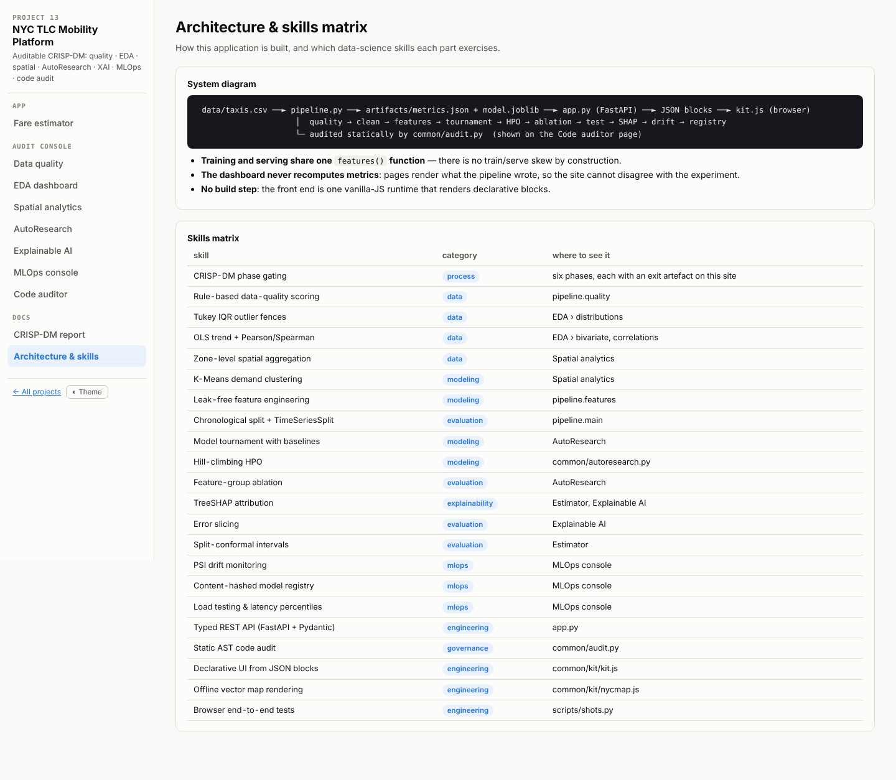

# Project 13 — NYC TLC Mobility Platform

> Auditable CRISP-DM: quality · EDA · spatial · AutoResearch · XAI · MLOps · code audit

**Walkthrough video (2 min):** _add link in `videos.json`_

## What it is
An auditable fare-prediction platform on real March-2019 NYC taxi trips: map-based fare estimator plus a ten-page audit console — data-quality scorecard, six-tab EDA, zone choropleths and demand clusters, tournament / HPO / ablation, TreeSHAP, MLOps (registry, PSI drift, load test, request log), a live code audit and a generated CRISP-DM report.

## Run it
```bash
# from the repository root
python run.py 13          # → http://127.0.0.1:8013
python run.py             # or the hub with all 16 projects → http://127.0.0.1:8000
python run.py train 13    # re-run the training pipeline and rebuild artifacts/
```

## Results (read from `artifacts/metrics.json` by `scripts/build_docs.py`)
- Test MAE **$1.21** (tariff-formula baseline $1.68, median baseline $6.21); R² 0.953.
- Within $1 for 61% of trips, within $2 for 84%; 80% interval coverage 83%.
- Ablation: removing distance features raises CV MAE by $1.38; temporal +$0.182; spatial +$0.078.
- Data quality 99.3% across six dimensions.
- Note: LightGBM had the best CV score by about one cent; XGBoost is shipped because its native TreeSHAP powers the per-trip explanation.
- Limit: one month, ~6k trips; route distance is an input.

## What I added beyond the reference prompt
- Chronological split and TimeSeriesSplit CV instead of random folds.
- The CRISP-DM report is generated from `metrics.json`, so it cannot disagree with the experiment.
- The code-auditor page runs the Project 11 auditor on this project's own pipeline at page load.
- Feature-group ablation and error slices by borough, hour and trip length.
- Offline choropleth maps from the TLC zone polygons.

## Pages
- **Fare estimator** (App)
- **Data quality** (Audit console)
- **EDA dashboard** (Audit console)
- **Spatial analytics** (Audit console)
- **AutoResearch** (Audit console)
- **Explainable AI** (Audit console)
- **MLOps console** (Audit console)
- **Code auditor** (Audit console)
- **CRISP-DM report** (Docs)
- **Architecture & skills** (Docs)

## Code map
- `pipeline.py` — quality, features, tournament, HPO, ablation, SHAP, PSI, registry
- `app.py` — estimator API, load test, ten console pages
- `web/custom.js` — map estimator and choropleths
- `../common/` — shared app factory, UI kit (`kit/kit.js`), AutoResearch hill-climber, static auditor

## Prompt this project replicates
```text
/teamwork-preview implement a new project with following crisp-dm methodology and engaging all the data science skills i have installed and engaging aprpopriate matt-pockock skills - pick a data set like nyc taxi data set. this should be done with extreme transparency of the report in website for data science auditors including code auditors of what has happened in data science side and code side as well as clean illustration of important code snippets through out the project. it should also do explainable ai and eda dashboards - all in website admin link. the crisp dm report should be a paper size of ten pages in depth explaining each step properly. the data analysis should include clustering visualization and all stages of data . the modeling should include auto research of various techniques and within each technique very detailed ablation and hyper parameter - everythign must be done as per text book style discipline  - stunning website for inference like before - include load test and inference rest apis - include full mlops demonstrated. prepare a preopr todo list for this very largish project and meticulously knock off each step with proper verifier. have a detailed data science expert auditor step for each to ensure eveyrthing is proeprly audited for compliance and corrected if needed and done as per the book - this is a demonstration of how to follow strict principled data science process.
```

## Screenshot tour
### Estimator


### Quality


### Eda


### Spatial


### Research


### Xai


### Mlops


### Auditor


### Paper


### Architecture


