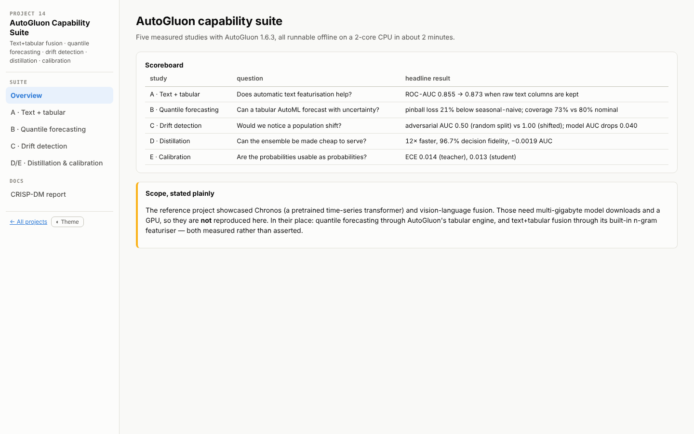
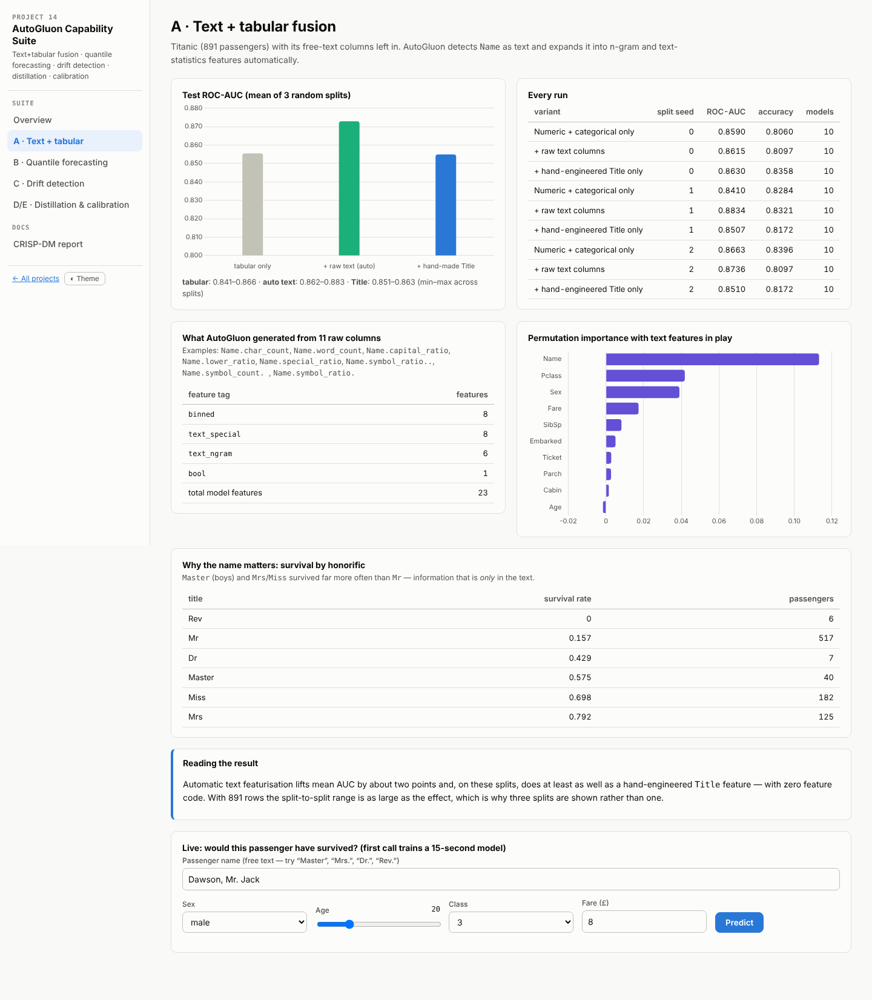
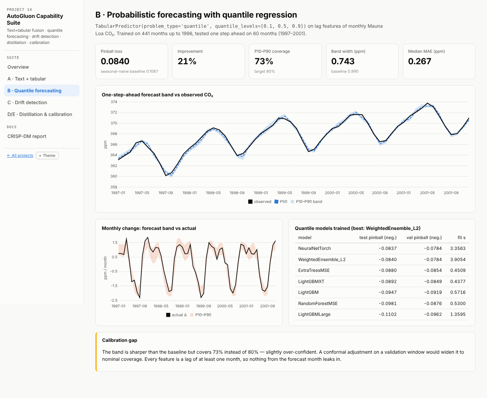
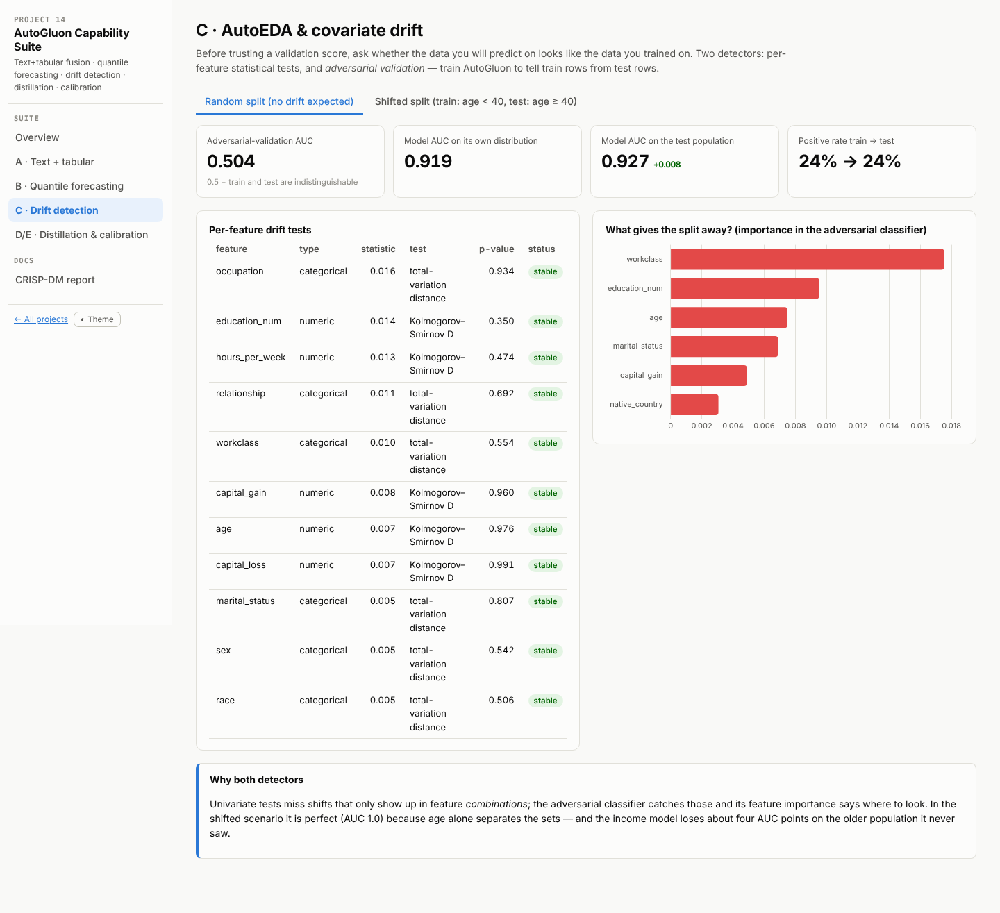
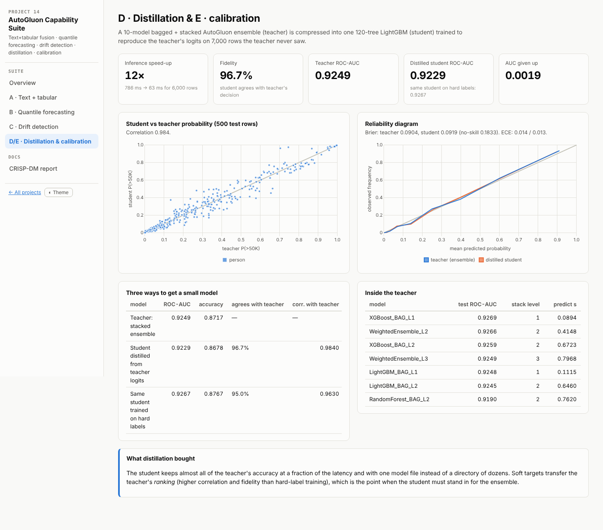
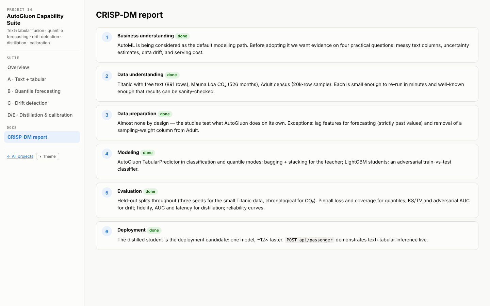

# Project 14 — AutoGluon Capability Suite

> Text+tabular fusion · quantile forecasting · drift detection · distillation · calibration

**Walkthrough video (2 min):** _add link in `videos.json`_

## What it is
Five measured AutoGluon studies: text + tabular fusion (Titanic with free-text names), probabilistic forecasting with quantile regression (CO₂), drift detection with adversarial validation, knowledge distillation of a stacked ensemble, and calibration.

## Run it
```bash
# from the repository root
python run.py 14          # → http://127.0.0.1:8014
python run.py             # or the hub with all 16 projects → http://127.0.0.1:8000
python run.py train 14    # re-run the training pipeline and rebuild artifacts/
```

## Results (read from `artifacts/metrics.json` by `scripts/build_docs.py`)
- Text + tabular: mean ROC-AUC 0.855 → **0.873** when raw text columns are kept (hand-made Title: 0.855).
- Quantile forecasting: pinball loss 0.0840 vs 0.1067 for seasonal-naive; P10–P90 coverage 73% (target 80%).
- Drift: adversarial AUC 0.50 vs 1.00 (random vs shifted split); model AUC on the shifted population drops 0.040.
- Distillation: **12×** faster, 96.7% decision fidelity, AUC 0.9249 → 0.9229.

## What I added beyond the reference prompt
- Scope stated plainly: the reference used Chronos and vision-language models, which need multi-GB downloads and a GPU. I replaced them with capabilities that run offline on CPU and measured each.
- Three random splits for the small Titanic study, so the effect is not a one-split accident.
- Adversarial validation plus the measured consequence of drift on model AUC.
- Distillation compared with the same student trained on hard labels.
- Live text + tabular demo: change only the honorific in a passenger's name.

## Pages
- **Overview** (Suite)
- **A · Text + tabular** (Suite)
- **B · Quantile forecasting** (Suite)
- **C · Drift detection** (Suite)
- **D/E · Distillation & calibration** (Suite)
- **CRISP-DM report** (Docs)

## Code map
- `pipeline.py` — the five studies
- `app.py` — report pages and `POST api/passenger`
- `../common/` — shared app factory, UI kit (`kit/kit.js`), AutoResearch hill-climber, static auditor

## Prompt this project replicates
```text
/teamwork_preview in similar fashion do a spectacular automl demo of various data science using autogluon packages latest package illustrating various capabilities
```

## Screenshot tour
### Overview


### Text


### Forecast


### Drift


### Distill


### Crispdm


