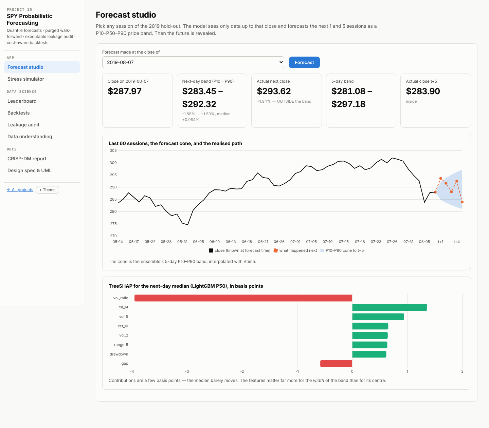
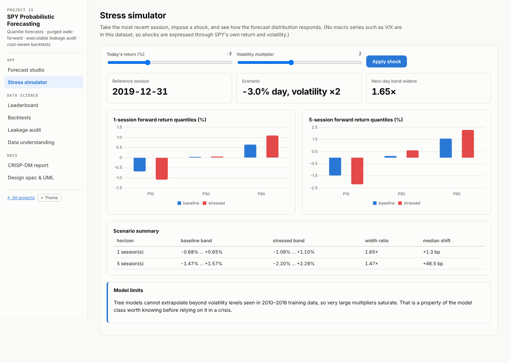
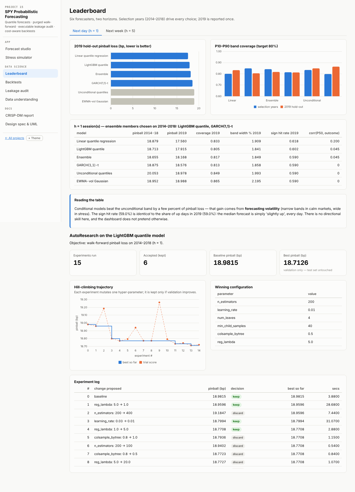
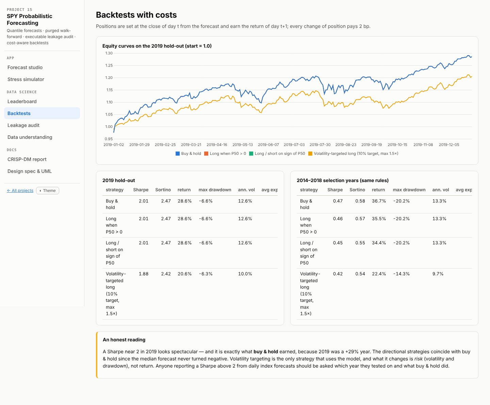
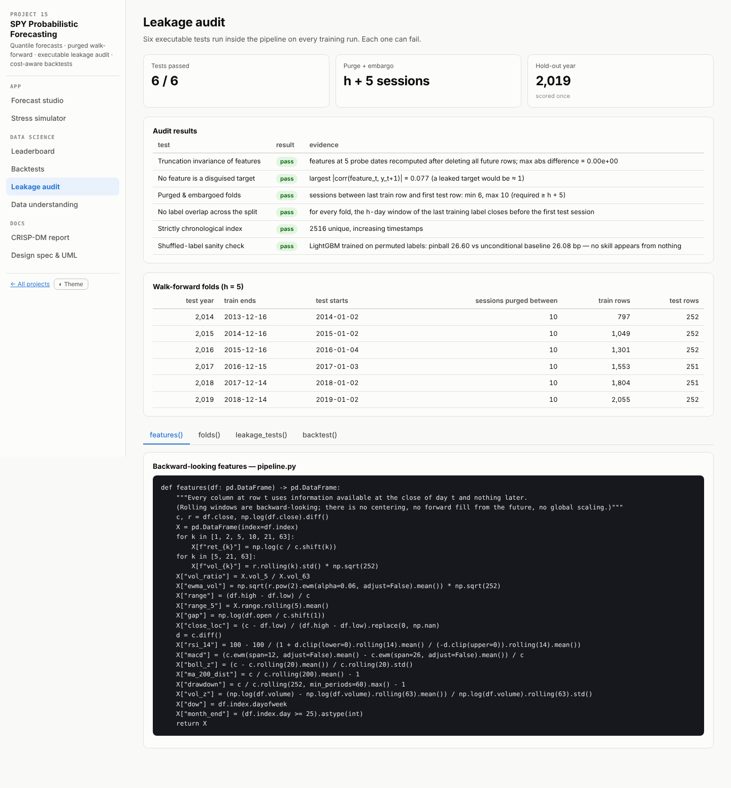
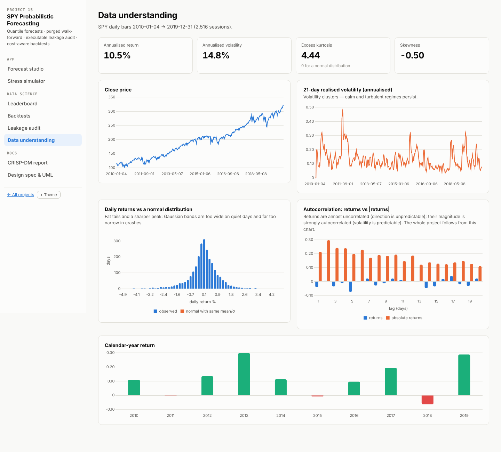
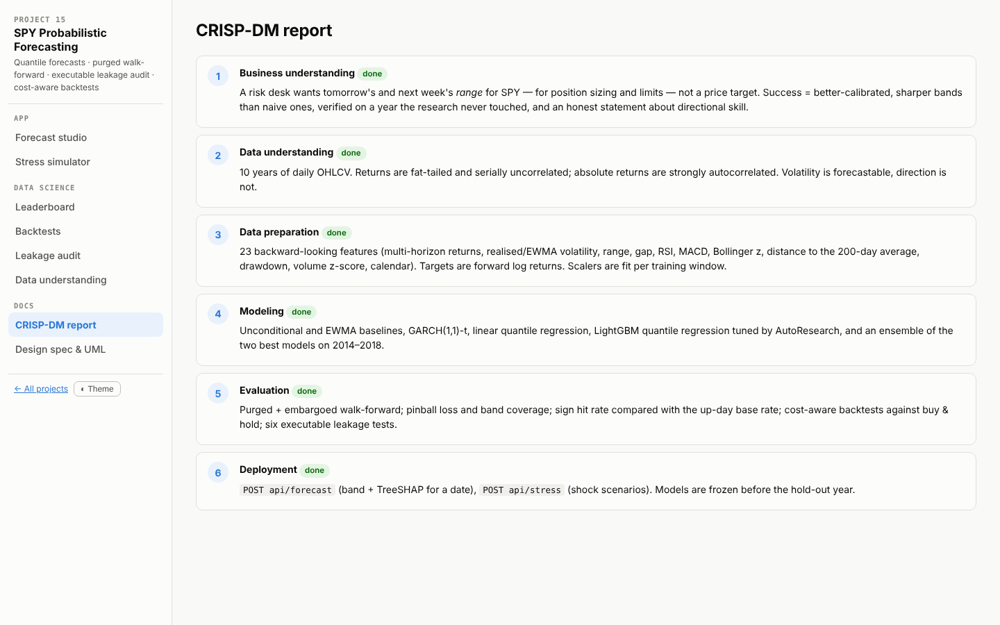
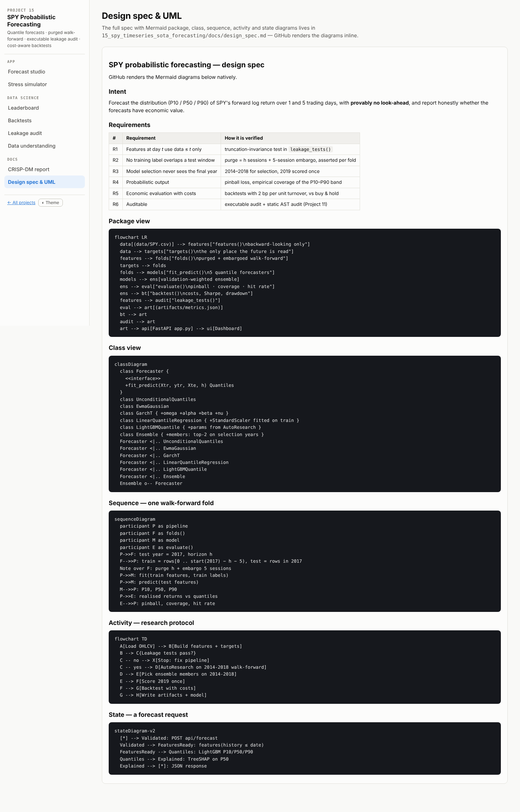

# Project 15 — SPY Probabilistic Forecasting

> Quantile forecasts · purged walk-forward · executable leakage audit · cost-aware backtests

**Walkthrough video (2 min):** _add link in `videos.json`_

## What it is
Probabilistic forecasting of SPY (P10 / P50 / P90 for 1 and 5 sessions ahead) on ten years of daily data, with purged + embargoed walk-forward validation, six executable leakage tests, cost-aware backtests, a stress simulator and a UML design spec.

## Run it
```bash
# from the repository root
python run.py 15          # → http://127.0.0.1:8015
python run.py             # or the hub with all 16 projects → http://127.0.0.1:8000
python run.py train 15    # re-run the training pipeline and rebuild artifacts/
```

## Results (read from `artifacts/metrics.json` by `scripts/build_docs.py`)
- 2,516 sessions, 23 backward-looking features; leakage tests 6/6 passed.
- 2019 hold-out pinball loss (h = 1, bp): Linear quantile regression 17.56; LightGBM quantile 17.91; Ensemble 18.17; unconditional baseline 18.98.
- Sign hit rate 59.0% — identical to the share of up days in 2019 (59.0%): **no directional skill**.
- 2019 Sharpe: buy & hold 2.01; the directional strategies coincide with it; volatility targeting 1.88 with lower volatility.
- Honest finding: the models add value in the *width* of the distribution (volatility), not in direction. A Sharpe near 2 in 2019 is what the market paid anyone who held SPY.
- Scope: Chronos / PatchTST / TFT from the reference need pretrained weights or a GPU and are not reproduced; no VIX or rates data is included.

## What I added beyond the reference prompt
- Executable leakage audit: features are recomputed after deleting all future rows and must not change; a shuffled-label model must show no skill; purge gaps are asserted.
- 2019 is a hold-out year scored once; all selection uses 2014–2018.
- Honest economics: the sign hit rate is compared with the share of up days, and every strategy is compared with buy & hold after costs.
- A stress simulator, and Mermaid UML (package, class, sequence, activity, state) that GitHub renders inline.

## Pages
- **Forecast studio** (App)
- **Stress simulator** (App)
- **Leaderboard** (Data science)
- **Backtests** (Data science)
- **Leakage audit** (Data science)
- **Data understanding** (Data science)
- **CRISP-DM report** (Docs)
- **Design spec & UML** (Docs)

## Code map
- `pipeline.py` — features, purged folds, forecasters, leakage tests, backtests
- `app.py` — `POST api/forecast`, `POST api/stress`
- `docs/design_spec.md` — spec with Mermaid UML
- `../common/` — shared app factory, UI kit (`kit/kit.js`), AutoResearch hill-climber, static auditor

## Prompt this project replicates
```text
/grill-me requirements for an end2end timeseries forecasting for stock index SPY using state of art Machine Learning techniques
/matt-pocock-to-spec please create a detailed design spec - ensure you do not have any data leakage in terms of features as a good data scientist - ensure there is a proper data science auditor which checks and verifies everything is done properly as per principles
/teamwork-preview generate me all the artifacts of a UML process for implementation plan so i can review and have a very detailed spec.md which satisfies the plan's intent.md
/teamwork-preview the markdown files do not inline the mermaid uml diagrams. can you help render them properly
```

## Screenshot tour
### Studio


### Stress


### Leaderboard


### Backtest


### Audit


### Eda


### Crispdm


### Spec


