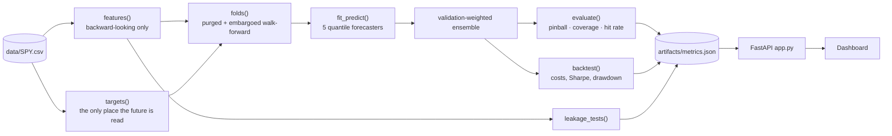
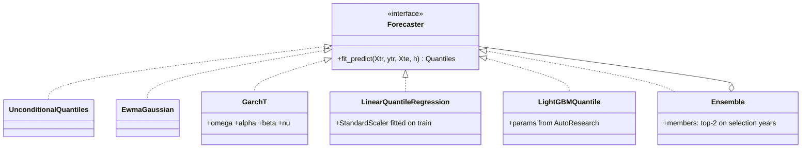
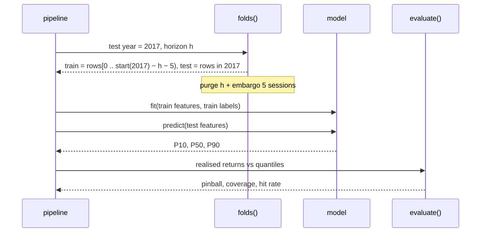
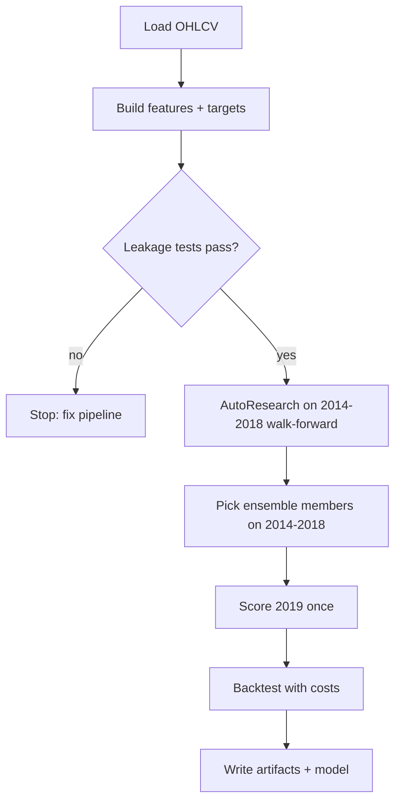
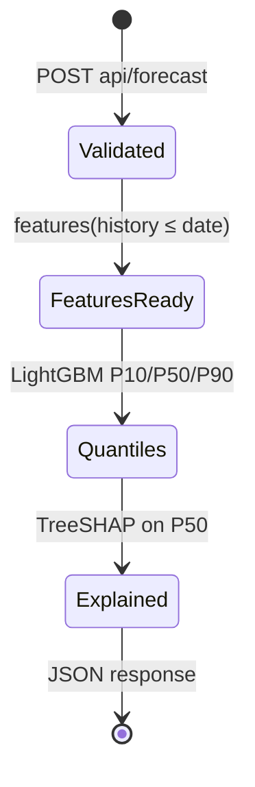

# SPY probabilistic forecasting — design spec

GitHub renders the Mermaid diagrams below natively.

## Intent
Forecast the distribution (P10 / P50 / P90) of SPY's forward log return over 1 and 5 trading days, with **provably no look-ahead**, and report honestly whether the forecasts have economic value.

## Requirements
| # | Requirement | How it is verified |
|---|---|---|
| R1 | Features at day *t* use data ≤ *t* only | truncation-invariance test in `leakage_tests()` |
| R2 | No training label overlaps a test window | purge = h sessions + 5-session embargo, asserted per fold |
| R3 | Model selection never sees the final year | 2014–2018 for selection, 2019 scored once |
| R4 | Probabilistic output | pinball loss, empirical coverage of the P10–P90 band |
| R5 | Economic evaluation with costs | backtests with 2 bp per unit turnover, vs buy & hold |
| R6 | Auditable | executable audit + static AST audit (Project 11) |

## Package view

## Class view

## Sequence — one walk-forward fold

## Activity — research protocol

## State — a forecast request

